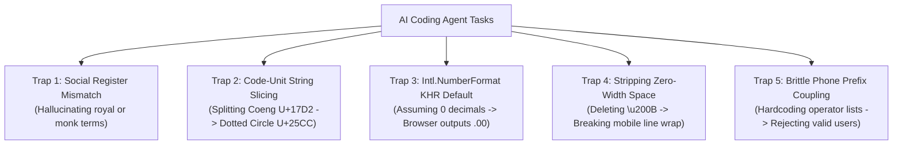

# Khmer Localization (`khmer-localization`) — Production AI Agent Skill for Cambodian Software Engineering

[](https://github.com/Chhunsour/khmer-localization/actions)
[](#testing--quality-assurance)
[](LICENSE)
[](https://www.python.org/)
[](https://agentskills.org)
[](https://unicode.org/charts/PDF/U1780.pdf)
[](https://trc.gov.kh)

The definitive open-source **Agent Skill** for AI coding assistants (**Google Antigravity**, **Claude Code**, **OpenAI Codex / ChatGPT**, **Gemini CLI**, **Cursor**, **GitHub Copilot**). It equips AI coding agents with verified domain knowledge, algorithmic safeguards, and battle-tested code patterns to build, localize, and audit production software for Khmer-speaking users and the Kingdom of Cambodia.

> [!NOTE]
> **What is an Agent Skill?**
> This repository packages an open-standard **developer tool and AI skill**, not a monolithic runtime library or demo application. Installing this skill teaches your AI coding assistant how to write, inspect, format, and verify Khmer localization across your own applications and codebases.

---

## Table of Contents

- [Overview & Value Proposition](#overview--value-proposition)
- [Agent Quick-Routing Matrix](#agent-quick-routing-matrix)
- [The 5 Fatal AI Localization Traps](#the-5-fatal-ai-localization-traps)
- [Core Engineering Pillars](#core-engineering-pillars)
  - [1. Khmer Unicode Integrity & OpenType Typography](#1-khmer-unicode-integrity--opentype-typography)
  - [2. Modern Digital Tech Microcopy & Register Control](#2-modern-digital-tech-microcopy--register-control)
  - [3. Cambodian Phone Number Engineering (+855)](#3-cambodian-phone-number-engineering-855)
  - [4. Dual-Currency Economics (USD & KHR)](#4-dual-currency-economics-usd--khr)
  - [5. Bakong KHQR EMVCo Fintech Standards & CRC16](#5-bakong-khqr-emvco-fintech-standards--crc16)
  - [6. Cambodian Administrative Hierarchy & Addresses](#6-cambodian-administrative-hierarchy--addresses)
  - [7. Cambodian Calendar, Dates, Times & Buddhist Era (BE)](#7-cambodian-calendar-dates-times--buddhist-era-be)
  - [8. Khmer Alphabetical Collation & GDT Number-to-Words](#8-khmer-alphabetical-collation--gdt-number-to-words)
  - [9. Mobile Responsive UX & Zero-Width Word Breaking](#9-mobile-responsive-ux--zero-width-word-breaking)
- [Production Framework Integration Recipes](#production-framework-integration-recipes)
- [Python Utility Module (`scripts/khmer_utils.py`)](#python-utility-module-scriptskhmer_utilspy)
- [Static Unicode & UTF-8 Audit Tool (`scripts/check_khmer_unicode.py`)](#static-unicode--utf-8-audit-tool-scriptscheck_khmer_unicodepy)
- [Installation by Agent Platform](#installation-by-agent-platform)
- [Frequently Asked Questions (FAQ) for Search & Answer Engines](#frequently-asked-questions-faq-for-search--answer-engines)
- [Authoritative Regulatory & Standards Citations](#authoritative-regulatory--standards-citations)
- [Testing & Quality Assurance](#testing--quality-assurance)
- [Contributing & License](#contributing--license)

---

## Overview & Value Proposition

Engineering software for the Cambodian market presents unique internationalization (i18n), linguistic, and regulatory challenges:
- **Complex Abugida Script:** Khmer uses consonant clusters with dynamic subscript consonants (ជើងអក្សរ) created via Coeng (`U+17D2`), dependent vowel signs, and diacritics that render across three vertical tiers. Naive string operations produce broken **dotted circle artifacts (`U+25CC`)**.
- **No Inherent Word Delimiters:** Khmer is written without visible spaces between words. Web browsers without dictionary-based line breakers either overflow containers or break words mid-syllable unless soft break opportunities (Zero-Width Space `\u200B` / ZWSP) are injected.
- **Dual-Currency Circulation:** Daily commerce in Cambodia operates simultaneously in **Cambodian Riel (KHR / ៛)** and **United States Dollars (USD / $)**. Standard ECMAScript / ICU implementations of `Intl.NumberFormat` mistakenly format KHR with two decimal places (`25,000.00៛`) by default, requiring explicit whole-riel configuration.
- **Unique Telecommunications Plan:** The Telecommunication Regulator of Cambodia (TRC) and ITU-T Recommendation E.164 mandate closed 8-digit and extended 9-digit National Significant Numbers (NSN) under country calling code `+855`.
- **National QR Payment System (Bakong KHQR):** The National Bank of Cambodia (NBC) operates a universal EMVCo-compliant payment rail requiring precise bilingual labeling, currency isolation, and CRC16 checksum calculation.
- **4-Tier Administrative Divisions:** Addressing follows a distinct structure: Province/Capital (`រាជធានី-ខេត្ត`) $\rightarrow$ District/Khan (`ស្រុក/ខណ្ឌ/ក្រុង`) $\rightarrow$ Commune/Sangkat (`ឃុំ/សង្កាត់`) $\rightarrow$ Village (`ភូមិ`).
- **GDT Tax Invoice Compliance:** Tax authorities require official invoices to spell out numbers in Khmer words (`ពីរម៉ឺនប្រាំពាន់រៀលគត់`).
- **AI Register Hallucinations:** Large language models frequently hallucinate archaic royal vocabulary (*Reachasap* / រាជសព្ទ) or Buddhist monk vocabulary (*Sanghasap* / សង្ឃសព្ទ) when asked for standard user interface copy.

`khmer-localization` solves these challenges comprehensively by providing deterministic rules, verified code templates, and automated auditing scripts directly into your AI assistant's context.

---

## Agent Quick-Routing Matrix

For AI coding agents (Claude, Codex, Gemini, Antigravity), use this lookup matrix to navigate directly to the verified implementation pattern:

| User Task / Problem | Immediate Agent Action | Primary Reference |
| :--- | :--- | :--- |
| **Translate or review UI copy** | Use natural, active tech verbs (`ចូល`, `ដាក់ស្នើ`, `ចុះឈ្មោះ`); eliminate royal/monk vocabulary. | [Khmer Writing Guide](./references/khmer-writing-guide.md) |
| **Cambodian phone input (+855)** | Use `normalizeCambodianPhone` (8/9-digit NSN; decouple prefix tables; preserve OTP boundary). | [Cambodia Formatting Guide](./references/cambodia-formatting.md) |
| **Currency formatting (KHR / USD)** | Configure `{ minimumFractionDigits: 0, maximumFractionDigits: 0 }` for whole-riel prices. | [Cambodia Formatting Guide](./references/cambodia-formatting.md) |
| **QR Payments / Fintech (KHQR)** | Generate EMVCo TLV payload, currency 116 (KHR) or 840 (USD), compute CRC16. | [Khmer Fintech & KHQR](./references/khmer-fintech-and-khqr.md) |
| **Addresses & delivery forms** | Model 4-tier hierarchy: Province (`រាជធានី/ខេត្ត`) $\rightarrow$ District $\rightarrow$ Sangkat $\rightarrow$ Village. | [Administrative Divisions](./references/cambodia-administrative-divisions.md) |
| **Number to Khmer words (Invoices)** | Convert amounts to formal Khmer currency words (`ពីរម៉ឺនប្រាំពាន់រៀលគត់`) for GDT. | [Collation & Number Words](./references/khmer-collation-and-number-words.md) |
| **Khmer alphabetical sorting** | Use `Intl.Collator("km-KH", { sensitivity: "base" })` per Chuon Nath dictionary order. | [Collation & Number Words](./references/khmer-collation-and-number-words.md) |
| **Dates, Calendars & Buddhist Era** | Use solar months (មករា..ធ្នូ), day-first format `DD/MM/YYYY`, $\text{BE} = \text{CE} + 543$. | [Cambodia Formatting Guide](./references/cambodia-formatting.md) |
| **Diacritic clipping on mobile** | Apply CSS `line-height: 1.6`–`1.8`, `min-h-[44px]`, `includeFontPadding: false` (Android). | [Unicode & Typography](./references/unicode-and-typography.md) |
| **Word breaking / container overflow** | Use `insertKhmerWordBreaks` with `Intl.Segmenter` + CSS `overflow-wrap: break-word`. | [Unicode & Typography](./references/unicode-and-typography.md) |
| **String truncation & dotted circles** | Truncate grapheme clusters with `Intl.Segmenter` (never slice after Coeng `U+17D2`). | [Unicode & Typography](./references/unicode-and-typography.md) |
| **Python utility library** | Import `normalize_cambodian_phone`, `format_khr`, `number_to_khmer_words`, `crc16`. | [Khmer Utils Module](./scripts/khmer_utils.py) |
| **Static code check / CI gate** | Run `python3 scripts/check_khmer_unicode.py --strict --json <path>` | [Checker Script](./scripts/check_khmer_unicode.py) |

---

## The 5 Fatal AI Localization Traps

Before generating code or translations, AI agents must avoid these 5 prevalent pitfalls:



1. **The Social Register Trap:** Never output royal (*Reachasap* / រាជសព្ទ) or monk (*Sanghasap* / សង្ឃសព្ទ) vocabulary (e.g. `យាង`, `សោយ`, `និមន្ត`, `ឆាន់`). Modern consumer software uses neutral, respectful tech terminology.
2. **The Code-Unit Slicing Trap:** Never truncate Khmer strings using `.slice(0, n)` or `.substring()`. Slicing between a base consonant and a combining vowel, or immediately after Coeng (`\u17D2`), produces an invalid Unicode sequence that displays as a broken **dotted circle (`U+25CC`)**. Always use grapheme-aware segmenters (`Intl.Segmenter`).
3. **The Intl Currency Default Trap:** Never assume `new Intl.NumberFormat('km-KH', { style: 'currency', currency: 'KHR' })` formats whole riel by default. In ECMAScript / ICU implementations, it defaults to **2 decimal places (`25,000.00៛`)** per ISO 4217 minor units. You **MUST** pass `{ minimumFractionDigits: 0, maximumFractionDigits: 0 }`.
4. **The Whitespace Stripping Trap:** Never run regexes like `replace(/\s+/g, '')` that strip Zero-Width Spaces (`\u200B` / ZWSP). Khmer relies on ZWSP for word breaking; stripping it causes text to overflow containers or wrap across consonants.
5. **The Carrier Prefix & Liveness Trap:** Never reject phone numbers because their operator prefix is unlisted (prefixes change under TRC regulatory updates). Never claim a number is "active" or "verified" without an SMS OTP check.

---

## Core Engineering Pillars

### 1. Khmer Unicode Integrity & OpenType Typography

The Khmer script is an **abugida** encoded across two Unicode blocks:
- **Khmer Block:** `U+1780` – `U+17FF` (Consonants, Independent Vowels, Dependent Vowels, Coeng, Digits)
- **Khmer Symbols Block:** `U+19E0` – `U+19FF` (Divination and lunar calendar signs)

#### Syllable Structure & The Coeng Sequence
Subscript consonants (ជើងអក្សរ) do not have dedicated single-character code points. They are formed dynamically via a two-character sequence:
$$\text{Subscript Consonant} = \text{U+17D2 (Coeng)} + \text{Base Consonant}$$

**Example Syllable Composition (`កម្ពុជា` — Cambodia):**
1. Consonant Ka: `U+1780` (`ក`)
2. Consonant Mo: `U+1798` (`ម`)
3. Subscript sequence: Coeng `U+17D2` + Consonant Po `U+1796` (`ព`) $\rightarrow$ forms subscript **កម្ព**
4. Dependent Vowel U: `U+17BB` $\rightarrow$ forms **កម្ពុ**
5. Consonant Jo: `U+1787` (`ជ`)
6. Dependent Vowel Aa: `U+17B6` $\rightarrow$ forms **កម្ពុជា**

#### Safe Grapheme Cluster Truncation
```typescript
export function safeTruncateKhmer(text: string, maxGraphemes: number): string {
  if (!text) return "";
  const segmenter = new Intl.Segmenter("km", { granularity: "grapheme" });
  const segments = Array.from(segmenter.segment(text));

  if (segments.length <= maxGraphemes) return text;
  return segments.slice(0, maxGraphemes).map((s) => s.segment).join("") + "…";
}
```

---

### 2. Modern Digital Tech Microcopy & Register Control

Khmer digital interfaces prioritize concise, active verbs over clumsy bureaucratic noun phrases or literal translations:

| English UI Term | Standard Modern Khmer UI | Awkward Machine Translation (Avoid) | Problem with Literal Translation |
| :--- | :--- | :--- | :--- |
| **Sign In / Log In** | **ចូល** / **ចូលគណនី** | ចុះហត្ថលេខាលើ | Literal: "putting a pen signature on paper" |
| **Sign Up / Register** | **ចុះឈ្មោះ** | ការចុះបញ្ជីឈ្មោះចូល | Heavy bureaucratic noun phrase |
| **Submit** | **ដាក់ស្នើ** / **បញ្ជូន** | បញ្ជូនទៅកាន់ម៉ាស៊ីនបម្រើ | Verbose: "dispatch towards server machine" |
| **Save** | **រក្សាទុក** | សេវ / ធ្វើការសន្សំ | "សេវ" is raw slang; "សន្សំ" means saving cash |
| **Delete** | **លុប** / **លុបចេញ** | ឌីលីត / សម្លាប់ | "ឌីលីត" is phonetic slang; "សម្លាប់" means to kill |
| **Confirm** | **បញ្ជាក់** | ខនហ្វឺម | Phonetic transliteration |
| **Cancel** | **បោះបង់** | បោះបង់ចោល | "ចោល" adds visual clutter on buttons |
| **Dropdown Menu** | **បញ្ជីជ្រើសរើស** | ទម្លាក់ចុះ | Physics translation: "falling downwards" |
| **Welcome** | **សូមស្វាគមន៍** | យាងមកកាន់ | "យាង" is royal language (*Reachasap*) |

---

### 3. Cambodian Phone Number Engineering (+855)

Under ITU-T Recommendation E.164 and the Telecommunication Regulator of Cambodia (TRC) National Numbering Plan, Cambodia uses a closed numbering plan:
- **Country Calling Code:** `+855`
- **Domestic Trunk Prefix:** `0` (used when dialing domestically; dropped in international E.164)
- **National Significant Number (NSN) Length:** **8 or 9 digits** depending on operator tier.

#### Normalization Implementation
```typescript
export function normalizeCambodianPhone(input: string): PhoneNormalizationResult {
  // 1. Strip symbols and normalize Khmer numerals (០-៩) to ASCII
  let cleaned = input.replace(/[\s\-\(\)\.]+/g, "");
  cleaned = cleaned.replace(/[\u17E0-\u17E9]/g, (ch) => String(ch.charCodeAt(0) - 0x17E0));

  // 2. Strip international country code and domestic trunk
  let nationalNumber = cleaned;
  if (nationalNumber.startsWith("+855")) nationalNumber = nationalNumber.slice(4);
  else if (nationalNumber.startsWith("00855")) nationalNumber = nationalNumber.slice(5);
  else if (nationalNumber.startsWith("855")) nationalNumber = nationalNumber.slice(3);
  else if (nationalNumber.startsWith("0")) nationalNumber = nationalNumber.slice(1);

  if (nationalNumber.startsWith("0")) nationalNumber = nationalNumber.slice(1);
  if (!/^\d+$/.test(nationalNumber)) return { isValidSyntax: false, ... };

  // 3. Length verification (8 digits standard, 9 digits extended mobile)
  const is8 = nationalNumber.length === 8;
  const is9 = nationalNumber.length === 9;
  if (!is8 && !is9) return { isValidSyntax: false, ... };

  return {
    nsn: nationalNumber,
    normalizedE164: `+855${nationalNumber}`,
    normalizedDomestic: `0${nationalNumber}`,
    isValidSyntax: true,
    requiresOtpVerification: true,
    isActiveSim: false,
  };
}
```

---

### 4. Dual-Currency Economics (USD & KHR)

Cambodia operates a dual-currency financial economy:
- **Cambodian Riel (KHR / ៛):** Circulates without physical coins/cents. The smallest banknote is 100 ៛. Consumer prices are expressed as **whole riel without decimals** (`25,000 ៛`).
- **United States Dollar (USD / $):** Used extensively for commerce, electronic payments, and banking. Formats with **2 decimal places** (`$25.00`).

```typescript
export function formatKHR(amount: number, wholeRiel: boolean = true): string {
  return new Intl.NumberFormat("km-KH", {
    style: "currency",
    currency: "KHR",
    minimumFractionDigits: wholeRiel ? 0 : 2,
    maximumFractionDigits: wholeRiel ? 0 : 2,
  }).format(amount);
}

export function formatUSD(amount: number): string {
  return new Intl.NumberFormat("en-US", {
    style: "currency",
    currency: "USD",
    minimumFractionDigits: 2,
    maximumFractionDigits: 2,
  }).format(amount);
}
```

---

### 5. Bakong KHQR EMVCo Fintech Standards & CRC16

The **National Bank of Cambodia (NBC)** operates **Bakong**, the national payment switch. Its QR code standard, **KHQR**, follows the EMVCo Merchant-Presented Mode (MPM) specification.

#### Key Tag Mapping:
- **Tag 00:** Payload Version (`01`)
- **Tag 01:** Point of Initiation (`11` Static, `12` Dynamic)
- **Tag 29:** Individual Account Info (contains sub-tag `00` Bakong ID)
- **Tag 30:** Corporate Merchant Info (contains sub-tag `00` Bakong ID, `01` Merchant ID)
- **Tag 53:** Currency (`116` for KHR, `840` for USD)
- **Tag 54:** Amount (Integer whole-riel for KHR; 2 decimals for USD)
- **Tag 63:** CRC16-CCITT-FALSE Checksum (4 uppercase hex digits over all characters including `6304`)

See [references/khmer-fintech-and-khqr.md](./references/khmer-fintech-and-khqr.md) for full generator and parser code.

---

### 6. Cambodian Administrative Hierarchy & Addresses

Cambodian addresses follow a strict 4-tier civilian administrative hierarchy:
$$\text{Province / Capital (រាជធានី-ខេត្ត)} \rightarrow \text{District / Khan / Municipality (ស្រុក/ខណ្ឌ/ក្រុង)} \rightarrow \text{Commune / Sangkat (ឃុំ/សង្កាត់)} \rightarrow \text{Village (ភូមិ)}$$

- **Tier 1:** 25 Divisions (1 Autonomous Municipality: Phnom Penh `KH-12`, and 24 Provinces).
- **Domestic Couriers:** Rely on recipient phone numbers, Sangkat, Khan, and **Landmarks/Directions** rather than postal codes.

See [references/cambodia-administrative-divisions.md](./references/cambodia-administrative-divisions.md) for complete ISO 3166-2:KH code listings and address form models.

---

### 7. Cambodian Calendar, Dates, Times & Buddhist Era (BE)

- **Solar Month Names:** មករា (Jan), កុម្ភៈ (Feb), មីនា (Mar), មេសា (Apr), ឧសភា (May), មិថុនា (Jun), កក្កដា (Jul), សីហា (Aug), កញ្ញា (Sep), តុលា (Oct), វិច្ឆិកា (Nov), ធ្នូ (Dec).
- **Date Ordering:** Day precedes month (`DD/MM/YYYY` or `ថ្ងៃទីDD ខែMM ឆ្នាំYYYY`).
- **Buddhist Era (BE) Formula:**
  $$\text{Year (BE)} = \text{Year (CE)} + 543 \quad (2026\text{ CE} = 2569\text{ BE})$$
- **12-Hour Period Qualifiers:** ព្រឹក (*Pruk*, Morning), រសៀល (*Rosiel*, Afternoon), ល្ងាច (*Lngeach*, Evening), យប់ (*Yob*, Night).

---

### 8. Khmer Alphabetical Collation & GDT Number-to-Words

1. **Chuon Nath Dictionary Collation:** Khmer alphabetical ordering sorts by 33 consonants (`ក..អ`), independent vowels, dependent vowel signs, and Coeng subscript consonants. Use `Intl.Collator("km-KH", { sensitivity: "base", numeric: true })` instead of raw Unicode code-point sorting.
2. **Number-to-Words Spellout:** Official tax invoices for the General Department of Taxation (GDT) require currency amounts to be spelled out using the Khmer numerical scale (ដប់, រយ, ពាន់, ម៉ឺន, សែន, លាន).
   - `25,000 ៛` $\rightarrow$ `ពីរម៉ឺនប្រាំពាន់រៀលគត់`
   - `150,000 ៛` $\rightarrow$ `មួយសែនប្រាំម៉ឺនរៀលគត់`

See [references/khmer-collation-and-number-words.md](./references/khmer-collation-and-number-words.md) for complete implementations.

---

### 9. Mobile Responsive UX & Zero-Width Word Breaking

Khmer lacks visible word boundaries. Web browsers without built-in ICU Khmer dictionaries break lines at random characters.

```typescript
export function insertKhmerWordBreaks(text: string): string {
  if (!text || typeof Intl === "undefined" || !("Segmenter" in Intl)) return text;
  const segmenter = new Intl.Segmenter("km", { granularity: "word" });
  const segments = Array.from(segmenter.segment(text));

  let result = "";
  for (let i = 0; i < segments.length; i++) {
    const seg = segments[i];
    result += seg.segment;
    if (
      seg.isWordLike &&
      /[\u1780-\u17FF]/.test(seg.segment) &&
      i + 1 < segments.length &&
      segments[i + 1].isWordLike &&
      /[\u1780-\u17FF]/.test(segments[i + 1].segment)
    ) {
      result += "\u200B";
    }
  }
  return result;
}
```

---

## Production Framework Integration Recipes

### Next.js App Router (`app/layout.tsx`)
```tsx
import { Kantumruy_Pro } from "next/font/google";
import "./globals.css";

const kantumruy = Kantumruy_Pro({
  subsets: ["khmer", "latin"],
  weight: ["400", "500", "600", "700"],
  variable: "--font-khmer",
  display: "swap",
});

export default function RootLayout({ children }: { children: React.ReactNode }) {
  return (
    <html lang="km" className={kantumruy.variable}>
      <body className="font-khmer leading-relaxed antialiased">{children}</body>
    </html>
  );
}
```

### Tailwind CSS (`tailwind.config.ts`)
```typescript
import type { Config } from "tailwindcss";

const config: Config = {
  theme: {
    extend: {
      fontFamily: {
        khmer: ["var(--font-khmer)", "Kantumruy Pro", "Noto Sans Khmer", "sans-serif"],
      },
      lineHeight: {
        "khmer-tight": "1.5",
        "khmer-normal": "1.7",
        "khmer-relaxed": "1.85",
      },
      minHeight: {
        "touch-target": "44px",
      },
    },
  },
};
export default config;
```

### React Native / Expo (`StyleSheet`)
```typescript
import { StyleSheet, Platform } from "react-native";

export const styles = StyleSheet.create({
  khmerText: {
    fontFamily: Platform.select({ ios: "Khmer Sangam MN", android: "NotoSansKhmer-Regular" }),
    fontSize: 16,
    lineHeight: 28, // 1.75x font size for vertical diacritic clearance
    includeFontPadding: false, // Critical Android fix: prevents cutting off subscripts
    textAlignVertical: "center",
  },
  khmerButton: {
    minHeight: 48,
    paddingVertical: 12,
    paddingHorizontal: 16,
  },
});
```

---

## Python Utility Module (`scripts/khmer_utils.py`)

A zero-dependency reference Python module implementing all core localization algorithms:

```bash
# Normalize phone number to E.164
python3 scripts/khmer_utils.py phone "012 345 678"

# Spell out currency amounts in Khmer words (GDT invoice compliance)
python3 scripts/khmer_utils.py words 25000 --currency KHR
# Outputs: ពីរម៉ឺនប្រាំពាន់រៀលគត់

# Format date with Buddhist Era
python3 scripts/khmer_utils.py date 2026-10-20 --be
# Outputs: ថ្ងៃទី 20 ខែតុលា ឆ្នាំ 2026 (ព.ស. 2569)

# Compute CRC16 checksum for KHQR payload
python3 scripts/khmer_utils.py khqr-crc "00020101021129330017sokha@devb5204541153031165405250005802KH5912AngkorCoffee6010Phnom Penh6304"
```

---

## Static Unicode & UTF-8 Audit Tool (`scripts/check_khmer_unicode.py`)

The bundled `check_khmer_unicode.py` script inspects codebases for corrupted characters (`U+FFFD`), suspicious control codes, and orphaned combining marks. Zero third-party dependencies (Python 3.10+ standard library):

```bash
# Standard directory scan
python3 scripts/check_khmer_unicode.py path/to/locales/

# Strict CI mode: exit code 1 on warnings
python3 scripts/check_khmer_unicode.py --strict src/

# Structured JSON output for automated agents & CI
python3 scripts/check_khmer_unicode.py --strict --json .
```

---

## Machine-Readable Cambodian Data Catalogs (`data/`)

The repository includes curated, zero-dependency offline JSON datasets for Cambodian software engineering:
- **`data/provinces.json`**: All 25 ISO 3166-2:KH provinces and autonomous municipality with bilingual names and district counts.
- **`data/banknotes.json`**: 11 Cambodian Riel (KHR) currency denominations with Khmer numerals and security motifs.
- **`data/telecom_operators.json`**: Cambodian telecommunication network operators, ITU-T MCC-MNC codes, and TRC prefixes.
- **`data/public_holidays.json`**: Cambodian statutory national public holidays with bilingual names and types.
- **`data/bakong_members.json`**: National Bank of Cambodia Bakong participant commercial banks and microfinance institutions.
- **`data/khmer_symbols.json`**: Unicode codepoints, names, and typographical usage rules for Khmer punctuation marks (។, ៕, ៖, ៗ, ៘, ៚, ៛).
- **`data/khmer_keyboard.json`**: Standard NiDA / Khmer OS keyboard layout key mapping for 33 consonants and subscripts.
- **`data/phnom_penh_districts.json`**: All 14 Khans of Phnom Penh with administrative codes and commune counts.
- **`data/siem_reap_districts.json`**: All 12 districts of Siem Reap province including Angkor heritage zones.
- **`data/battambang_districts.json`**: All 14 districts of Battambang province.
- **`data/khmer_independent_vowels.json`**: 14 non-deprecated Khmer independent vowels with phonetic romanizations.
- **`data/cambodia_postal_codes.json`**: Major provincial and border logistic hub postal codes.
- **`data/khqr_mcc_codes.json`**: ISO 18245 Merchant Category Codes for NBC Bakong KHQR Tag 52.

---

## Installation by Agent Platform

### 1. Google Antigravity & Gemini CLI
**Project-Specific (Recommended):**
```bash
mkdir -p .agents/skills
cp -r /path/to/khmer-localization .agents/skills/khmer-localization
```
**Global (User-Wide):**
```bash
mkdir -p ~/.gemini/config/skills
cp -r /path/to/khmer-localization ~/.gemini/config/skills/khmer-localization
```

### 2. OpenAI Codex / ChatGPT / `AGENTS.md`
**Project-Specific Installation:**
```bash
mkdir -p .agents/skills
cp -r /path/to/khmer-localization .agents/skills/khmer-localization
```
Reference the skill in your project root `AGENTS.md`:
```markdown
## Localization Skills
- [Khmer Localization](.agents/skills/khmer-localization/SKILL.md): Complete engineering guide for Khmer UI, phone numbers (+855), dual currencies (USD/KHR), KHQR, and Unicode safety.
```

### 3. Claude Code
**Project-Specific:**
```bash
mkdir -p .claude/skills
cp -r /path/to/khmer-localization .claude/skills/khmer-localization
```
**Global (User-Wide):**
```bash
mkdir -p ~/.claude/skills
cp -r /path/to/khmer-localization ~/.claude/skills/khmer-localization
```

---

## Frequently Asked Questions (FAQ) for Search & Answer Engines

### Q1: How do I format Cambodian Riel (KHR) without decimal zeros in JavaScript / TypeScript?
**A:** Standard `new Intl.NumberFormat('km-KH', { style: 'currency', currency: 'KHR' })` defaults to 2 decimal places (`25,000.00៛`) because ISO 4217 formally allocates 2 minor units to KHR. To display whole riel as expected in Cambodian retail, you **must explicitly configure fraction digits to 0**:
```javascript
new Intl.NumberFormat('km-KH', {
  style: 'currency',
  currency: 'KHR',
  minimumFractionDigits: 0,
  maximumFractionDigits: 0,
}).format(25000); // Outputs: "25,000៛"
```

### Q2: What are the valid mobile phone number lengths and formats in Cambodia?
**A:** Under Telecommunication Regulator of Cambodia (TRC) standards and ITU-T E.164:
- **Country Code:** `+855`
- **Domestic Trunk:** `0` (dropped internationally)
- **Standard Mobile (8-digit NSN):** 9 digits domestic with `0` (e.g., `012 345 678` $\rightarrow$ `+855 12 345 678`).
- **Extended Mobile (9-digit NSN):** 10 digits domestic with `0` (marked with `*` in the TRC plan, e.g., `096 123 4567` $\rightarrow$ `+855 96 123 4567`).

### Q3: Why does Khmer text render dotted circles (`U+25CC`) on screens?
**A:** The dotted circle (`U+25CC`) is rendered by OpenType shaping engines (HarfBuzz, CoreText, DirectWrite) when a combining mark, dependent vowel, or subscript consonant prefix (Coeng `U+17D2`) is orphaned without a valid base consonant. This usually occurs when strings are truncated using naive `.slice()` or `.substring()` across UTF-16 code units. Use `Intl.Segmenter` with `{ granularity: 'grapheme' }` to prevent syllable slicing.

### Q4: Why does Khmer text get cut off vertically on mobile buttons and cards?
**A:** Khmer glyphs span three vertical zones: ascenders (top vowels and diacritics like `U+17C6`), base consonants, and deep descenders (subscript consonants formed via Coeng `U+17D2`). Tight CSS line heights (`line-height: 1.0` or `1.2`) clip these glyphs. Set `line-height` to at least `1.6`–`1.8`, provide vertical padding (`py-2.5`), and set `includeFontPadding: false` on Android React Native.

### Q5: How do I calculate the Cambodian Buddhist Era (BE) from the Gregorian year?
**A:** The Buddhist Era (ពុទ្ធសករាជ - ព.ស.) in Cambodia is calculated by adding **543** to the Gregorian Christian Era (CE) year:
$$\text{Year (BE)} = \text{Year (CE)} + 543 \quad (2026\text{ CE} + 543 = 2569\text{ BE})$$

### Q6: Why do AI models generate royal language in Khmer software translations?
**A:** Many general LLMs are trained on historical, religious, and formal texts without register conditioning, causing them to generate royal terms (*Reachasap* / រាជសព្ទ) like `យាង` or `សោយ`. This skill provides explicit guardrails conditioning agents to use modern digital tech register (`ចូល`, `ដាក់ស្នើ`, `រក្សាទុក`).

### Q7: How do I generate and validate a Bakong KHQR QR code with CRC16?
**A:** Construct serialized EMVCo TLV blocks (Tag 00, 01, 29/30, 52, 53, 54, 58, 59, 60, 62), append `6304`, and compute the **CRC16-CCITT-FALSE** checksum (polynomial `0x1021`, initial `0xFFFF`) over the entire string. See [references/khmer-fintech-and-khqr.md](./references/khmer-fintech-and-khqr.md) for full code.

### Q8: How should addresses be modeled in Cambodian e-commerce and delivery forms?
**A:** Follow Cambodia's 4-tier hierarchy: Province/Capital (`រាជធានី-ខេត្ត`) $\rightarrow$ District/Khan (`ស្រុក/ខណ្ឌ/ក្រុង`) $\rightarrow$ Commune/Sangkat (`ឃុំ/សង្កាត់`) $\rightarrow$ Village (`ភូមិ`). In e-commerce checkout forms, never make postal codes mandatory; always collect recipient phone numbers and a dedicated **Landmark / Directions** field.

### Q9: How do I spell out currency amounts in Khmer words for tax invoices?
**A:** Convert the integer amount into Khmer numerical scales (ដប់, រយ, ពាន់, ម៉ឺន, សែន, លាន) and append `រៀលគត់` (Riel exact) or `ដុល្លារអាមេរិកគត់` (USD exact). E.g., `25,000 ៛` $\rightarrow$ `ពីរម៉ឺនប្រាំពាន់រៀលគត់`. See [references/khmer-collation-and-number-words.md](./references/khmer-collation-and-number-words.md).

---

## Authoritative Regulatory & Standards Citations

- **Telecommunication Regulator of Cambodia (TRC):** [https://trc.gov.kh](https://trc.gov.kh) — *National Numbering Plan & Mobile Operator Allocations* (verified October 2026).
- **National Bank of Cambodia (NBC):** [https://www.nbc.gov.kh](https://www.nbc.gov.kh) — *Bakong Payment System & KHQR Specifications*.
- **General Department of Taxation (GDT):** [https://www.tax.gov.kh](https://www.tax.gov.kh) — *E-Invoicing and Khmer Word Currency Requirements*.
- **International Telecommunication Union (ITU):** [ITU-T Recommendation E.164](https://www.itu.int/rec/T-REC-E.164) — *The International Public Telecommunication Numbering Plan (Cambodia +855)*.
- **The Unicode Consortium:** [Khmer Unicode Block Charts (U+1780..U+17FF)](https://unicode.org/charts/PDF/U1780.pdf).
- **ISO 4217 Currency Standard:** Maintenance Agency for Currency Codes (`KHR` numeric 116, minor unit 2).
- **ISO 3166-2:KH:** International standard for Cambodia's 25 primary administrative subdivisions.

---

## Testing & Quality Assurance

Run the comprehensive, zero-dependency offline test suite:

```bash
python3 -m unittest discover -s tests -p "test_*.py" -v
```

All **89 automated tests** run deterministically in ~1 second:
- `tests/test_check_khmer_unicode.py` (20 tests): Replacement character detection, C0/C1 control codes, ZWSP preservation, orphaned marks, trailing Coeng, and JSON CLI reporting.
- `tests/test_khmer_utils.py` (24 tests): Reusable Python library verification: phone normalization, currency formatting, dates/BE, safe truncation, number-to-words, text detection, character statistics, and Bakong KHQR CRC16 checksums.
- `tests/test_data_catalog.py` (6 tests): Automated integrity verification of offline JSON datasets: 25 ISO 3166-2:KH provinces, 11 banknote denominations, 10 telecom operators, 12 public holidays, and 10 Bakong members.
- `tests/test_extended_catalogs.py` (4 tests): Verification of district catalogs (Phnom Penh, Siem Reap, Battambang), 14 independent vowels, postal codes, and KHQR MCC codes.
- `tests/test_currency_formatting.py` (12 tests): KHR explicit whole-riel formatting, ISO 4217 runtime defaults, rounding of fractional amounts, multi-billion amounts, and live Node.js `Intl.NumberFormat` tests.
- `tests/test_date_and_formatting.py` (15 tests): Khmer month names, Buddhist Era calculation ($\text{BE} = \text{CE} + 543$), relative time formatting, grapheme cluster text truncation, and live Node.js `Intl.DateTimeFormat` / `Intl.Segmenter` tests.
- `tests/test_phone_normalization.py` (8 tests): E.164 normalization, 8-digit vs. 9-digit NSN lengths, Khmer numeral conversion, decoupling from carrier tables, and OTP verification boundary.

---

## Contributing & License

Contributions are welcome! Please review [CONTRIBUTING.md](CONTRIBUTING.md) for details on submitting pull requests and running tests.

Distributed under the [MIT License](LICENSE).
