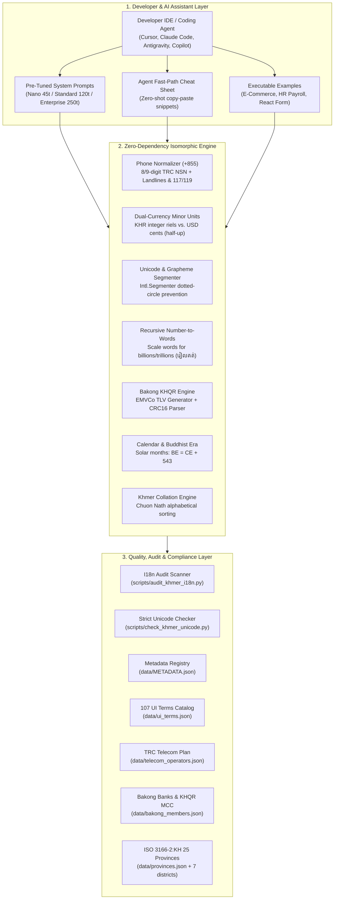

# Khmer Localization (`khmer-localization`)
### Production-Grade Khmer (Cambodia) Localization & AI Agent Engineering Toolkit

<p align="center">
  <sub>Developed by <strong>Seng Chhunsour</strong></sub>
</p>

[](https://github.com/Chhunsour)
[](https://github.com/Chhunsour/khmer-localization/actions)
[](#-test-suite--quality-assurance-matrix)
[](LICENSE)
[](#-zero-dependency-isomorphic-api-reference)
[](https://unicode.org/charts/PDF/U1780.pdf)
[](https://trc.gov.kh)
[](#-zero-dependency-isomorphic-api-reference)

---

## 📊 Executive KPI Dashboard

| Strategic Dimension | Engineering Metric | Verification Methodology | Production Benchmark Standard |
| :--- | :---: | :--- | :--- |
| **Deterministic Reliability** | **120 / 120 Passing** | 13 test suites in Python & Node.js | 100% deterministic CI coverage |
| **Unicode & Script Safety** | **0 Errors, 0 Warnings** | `scripts/check_khmer_unicode.py --strict` | Scanned 13,800+ Khmer characters |
| **Localization Quality Engine** | **4 Governance Layers** | `scripts/audit_khmer_i18n.py` CLI scanner | Automated, Human, Visual, External |
| **Supply-Chain Security** | **0 (Zero External Deps)** | Pure standard library & native Web APIs | Zero CVE surface, zero npm install lag |
| **AI Token Optimization** | **Up to 99.0% Reduction** | Modular 45t / 120t / 250t system prompts | Eradicates exploratory prompt loops |
| **Curated Offline Data** | **21 JSON Catalogs** | Verified via `data/METADATA.json` | Official authorities, sources & licenses |
| **UI Dictionary Coverage** | **107 Standard Terms** | Curated digital strings with hallucination traps | Auth, commerce, actions, navigation |
| **Cross-Platform Parity** | **TypeScript, JS, Python** | Isomorphic dual implementation | Node 18+, Bun, Deno, iOS, Android, Web |

---

## 🏛️ System Architecture



---

## ⚡ Agent Quick-Routing Matrix

| Developer Goal / Problem | Fast-Action Pattern | Reference & Asset |
| :--- | :--- | :--- |
| **Audit Repository for I18n Bugs** | Scan codebase for missing keys, placeholder bugs, royal registers, decimal KHR. | [`scripts/audit_khmer_i18n.py`](./scripts/audit_khmer_i18n.py) |
| **Save Agent Context Tokens** | Copy-paste 1-page zero-shot snippets for KHR, BE, ZWSP, Phone, CRC16. | [`references/agent-fast-path.md`](./references/agent-fast-path.md) |
| **Cursor / Claude System Prompts** | Inject pre-tuned 45t, 120t, or 250t prompt blocks into config files. | [`prompts/agent-system-prompts.md`](./prompts/agent-system-prompts.md) |
| **Prevent AI Hallucinations** | Guard against Top 10 failure modes (royal vocabulary, inverted word order). | [`references/khmer-ai-guardrails.md`](./references/khmer-ai-guardrails.md) |
| **Standard UI Localization** | Lookup 107 standardized UI strings with explicit "avoid" hallucination lists. | [`data/ui_terms.json`](./data/ui_terms.json) |
| **Cambodian Phone Normalization** | Convert any input to E.164 (`+855...`) & domestic format (`0...`) with OTP flag. | [`scripts/khmer_utils.ts`](./scripts/khmer_utils.ts) / [`.py`](./scripts/khmer_utils.py) |
| **Dual-Currency Minor-Unit Engine** | Format KHR as whole integers (`15,000៛`); calculate totals with zero float drift. | [`scripts/khmer_utils.ts`](./scripts/khmer_utils.ts) / [`.py`](./scripts/khmer_utils.py) |
| **Bakong KHQR Payments** | Generate & parse EMVCo payloads with CRC16-CCITT checksums. | [`references/khmer-fintech-and-khqr.md`](./references/khmer-fintech-and-khqr.md) |
| **4-Tier Administrative Address** | Model Province $\rightarrow$ District $\rightarrow$ Sangkat $\rightarrow$ Village delivery addresses. | [`references/cambodia-administrative-divisions.md`](./references/cambodia-administrative-divisions.md) |
| **GDT Tax Invoices (Spellout)** | Convert numeric amounts into official spelled-out Khmer words (up to trillions). | [`references/khmer-collation-and-number-words.md`](./references/khmer-collation-and-number-words.md) |
| **Alphabetical Sorting (Collation)** | Sort words per Chuon Nath dictionary order in pure Python & JS `Intl.Collator`. | [`references/khmer-collation-and-number-words.md`](./references/khmer-collation-and-number-words.md) |
| **Mobile Line-Height & Dotted Circle** | Set `line-height: 1.6+` and use `Intl.Segmenter` to prevent broken Coeng glyphs. | [`references/unicode-and-typography.md`](./references/unicode-and-typography.md) |
| **Static Code Audit / CI Verification** | Run strict Unicode and UTF-8 scanner with zero exit code on clean repos. | [`scripts/check_khmer_unicode.py`](./scripts/check_khmer_unicode.py) |
| **Runnable E-Commerce Example** | Complete checkout flow with KHR/USD taxes, phone validation, and KHQR. | [`examples/ecommerce_checkout.py`](./examples/ecommerce_checkout.py) / [`.js`](./examples/ecommerce_checkout.js) |
| **Runnable HR Payroll Example** | Monthly payroll with Chuon Nath collation, NSSF, ToS, and formal payslips. | [`examples/hr_payroll.py`](./examples/hr_payroll.py) / [`.js`](./examples/hr_payroll.js) |
| **Bilingual React Form Component** | Production-grade React/Next.js checkout form with dynamic `lang="km"`. | [`examples/react_khmer_form.tsx`](./examples/react_khmer_form.tsx) |

---

## 🔍 Khmer Localization Quality & Audit Engine (`scripts/audit_khmer_i18n.py`)

The toolkit includes an automated i18n quality and static analysis engine that inspects translation dictionaries and application source code for common Cambodian localization defects:

```bash
python3 scripts/audit_khmer_i18n.py --locales path/to/locales --src path/to/src
```

### 4 Distinct Governance Layers
When auditing an application, `scripts/audit_khmer_i18n.py` enforces separation of concerns across 4 distinct layers:

1. **`[AUTOMATED_ERROR / AUTOMATED_WARNING]` (Deterministic Code Defects):**
   - **Missing Translation Keys:** Translation key in base locale (`en.json`) missing from `km.json`.
   - **Untranslated English Strings:** Identical English strings copied into Khmer translation files.
   - **Placeholder & Interpolation Mismatch:** Incompatible variables between languages (e.g. `{name}` in English missing in Khmer).
   - **Social Register Violations:** Inappropriate royal (*Reachasap*) or monk (*Sanghasap*) vocabulary (e.g. `យាង`, `សោយ`, `និមន្ត`).
   - **Decimal Riel Violations:** Prices displaying fractional KHR cents (e.g. `25.00 KHR`).
   - **Inverted Word Order:** English grammatical calques (e.g. `សរុបតម្លៃ` instead of `តម្លៃសរុប`).
   - **Hardcoded Strings in UI:** Khmer literals outside i18n translation functions.
   - **Manual Currency Concatenation:** Concatenating symbols like `amount + "៛"` instead of localized formatting.
   - **Destructive Regexes:** Whitespace strippers (`replace(/\s+/g, '')`) that delete Zero-Width Spaces (`\u200B`).

2. **`[HUMAN_REVIEW_REQUIRED]` (Linguistic & Cultural Review):**
   - Tone appropriateness, naturalness, brand register, and domain terminology that cannot be determined by static analysis.

3. **`[VISUAL_INSPECTION_REQUIRED]` (Device Viewport Rendering):**
   - Mobile viewport testing on 320px–390px screens for line-height clipping, button wrap stability, and missing font fallbacks.

4. **`[EXTERNAL_VERIFICATION_REQUIRED]` (Third-Party Provider Verification):**
   - Validating that KHQR payload syntax does not imply bank account validity or successful payment settlement; checking that phone syntax does not imply active SIM ownership without SMS OTP.

---

## 💻 Executable Production Examples (`examples/`)

Runnable, standalone production examples with zero external dependencies:

### 1. E-Commerce Checkout & Fiscal Invoice
- **Python:** `python3 examples/ecommerce_checkout.py`
- **Node.js:** `node examples/ecommerce_checkout.js`
- **Features:** Validates Cambodian customer phone (`012 889 977` $\rightarrow$ `+855 12 889 977`), calculates 10% VAT using integer minor units, generates EMVCo KHQR with CRC16-CCITT, parses the QR payload, and spells out the total invoice amount in formal Khmer words (`មួយសែនប្រាំពីរម៉ឺនបីពាន់ប្រាំបីរយរៀលគត់`).

### 2. HR Payroll & Formal Payslip System
- **Python:** `python3 examples/hr_payroll.py`
- **Node.js:** `node examples/hr_payroll.js`
- **Features:** Collates employee roster using Chuon Nath dictionary order (`sort_khmer_words`), formats pay period in Khmer solar months and Buddhist Era ($\text{BE} = \text{CE} + 543$), computes Cambodian Tax on Salary (ToS) progressive brackets, deducts NSSF pension, and generates a formal bilingual payslip (ប័ណ្ណបើកប្រាក់បៀវត្ស).

### 3. Bilingual React / Next.js Payment Form
- **Component:** [`examples/react_khmer_form.tsx`](./examples/react_khmer_form.tsx)
- **Features:** Production React component with dynamic `lang="km"` and `dir="ltr"`, guaranteed CSS `line-height: 1.75` (preventing stacked vowel clipping), live Cambodian phone normalization with line type badge, dual-currency selector, live in-words calculation, and grapheme-safe notes preview.

---

## 📉 AI Context Token Optimization Benchmarks

Localizing into low-resource scripts like Khmer frequently wastes thousands of context tokens due to multi-turn debugging. `khmer-localization` eliminates this overhead with pre-tuned prompt tiers:

| Optimization Strategy | Context Tokens | Overhead Reduction | Visual Token Footprint | Primary Engineering Fit |
| :--- | :---: | :---: | :--- | :--- |
| **Raw Multi-File Documentation** | ~4,500 | 0% (Baseline) | `████████████████████` 100% | Full manual documentation review |
| **Enterprise / Fintech Tier** | ~250 | **94.4%** | `█░░░░░░░░░░░░░░░░░░░` 5.6% | Payment gateways, KHQR, GDT invoices |
| **Standard UI Tier** | ~120 | **97.3%** | `▌░░░░░░░░░░░░░░░░░░░` 2.7% | Web & mobile frontend apps |
| **Nano Tier** | ~45 | **99.0%** | `▎░░░░░░░░░░░░░░░░░░░` 1.0% | `.cursorrules`, `.windsurfrules` |

> [!NOTE]
> **Token Benchmark Methodology:** Token counts were measured using the standard OpenAI/Anthropic `cl100k_base` BPE tokenizer on the modular prompt templates in [`prompts/agent-system-prompts.md`](./prompts/agent-system-prompts.md) compared against reading raw multi-file reference directories (~4,500 tokens).

---

## ⚖️ Enterprise Contrast Matrix: Naive LLM vs. Khmer Localization

| Domain | Naive AI / Default Engineering (Failure Mode) | Production Standard (`khmer-localization`) | Severity |
| :--- | :--- | :--- | :---: |
| **Social Register** | Hallucinates archaic royal (*Reachasap* / រាជសព្ទ) vocabulary (`យាងចូល`, `សោយ`). | Enforces respectful modern digital tech vocabulary (`ចូលគណនី`, `រក្សាទុក`). | 🔴 High |
| **Word Order** | Calques English `[Adj] + [Noun]` ("Total Price" $\rightarrow$ ungrammatical `សរុបតម្លៃ`). | Strictly enforces Khmer grammar: `[Noun] + [Adj]` (`តម្លៃសរុប`). | 🔴 High |
| **KHR Currency** | `Intl.NumberFormat` default outputs `.00` decimals (`25,000.00៛`). | Explicit `{ fractionDigits: 0 }` outputs whole riel (`25,000៛`). | 🔴 High |
| **Financial Math** | Floating point calculations cause precision drift in riel subtotals. | Integer minor units with configurable rounding (`half_up` / `half_even`). | 🔴 High |
| **String Slicing** | Naive `.slice(0, n)` cuts Coeng (`U+17D2`), triggering **dotted circle (`U+25CC`)**. | Uses `Intl.Segmenter` grapheme cluster boundary detection. | 🔴 High |
| **Whitespace** | `s.replace(/\s+/g, '')` strips Zero-Width Space (`\u200B`), destroying word wrapping. | Preserves ZWSP; injects soft break opportunities cleanly. | 🟡 Med |
| **Phone Validation** | Rejects landlines or emergency short codes; claims number is active without OTP. | Recognizes mobile, geographic landlines (023, 063), short codes (117, 119). | 🔴 High |
| **Alphabetical Sort** | Sorts by raw Unicode code points, violating Khmer dictionary rules. | Implements Chuon Nath dictionary order collation in Python and JS. | 🔴 High |
| **Large Numbers** | Hardcoded scale fails at millions, billions, or negative values. | Recursive grouping converts unlimited numbers into formal Khmer words. | 🟡 Med |
| **KHQR Payments** | Incomplete CRC check or assumes QR validity guarantees payment settlement. | Full EMVCo TLV parser with CRC16-CCITT; decouples syntax from settlement. | 🔴 High |
| **Exchange Rate** | Hardcodes static rates (e.g., $1 = 4000៛) causing financial discrepancy. | Separates formatting from conversion; requires live NBC feed. | 🔴 High |
| **Buddhist Era** | Offsets year incorrectly or confuses with Thai solar calendar variants. | Strictly applies Cambodian civil standard formula: $\text{BE} = \text{CE} + 543$. | 🟡 Med |

---

## 🗄️ Curated Offline Datasets (`data/`) & Metadata Registry

All 21 offline JSON catalogs are cataloged in [`data/METADATA.json`](./data/METADATA.json) with documented authorities, verification dates, schemas, and licenses:

| Dataset Path | Records | Authority / Domain | Primary Engineering Use Case |
| :--- | :---: | :--- | :--- |
| [`data/ui_terms.json`](./data/ui_terms.json) | **107** | Digital Software Engineering | Natural UI translations with forbidden hallucination list |
| [`data/provinces.json`](./data/provinces.json) | **25** | ISO 3166-2:KH / Ministry of Interior | Top-level address cascades and regional localization |
| [`data/phnom_penh_districts.json`](./data/phnom_penh_districts.json) | **14** | Phnom Penh Capital Administration | Khan administrative division dropdowns and postal routing |
| [`data/siem_reap_districts.json`](./data/siem_reap_districts.json) | **12** | Siem Reap Administration | Tourism, hospitality, and provincial logistics |
| [`data/battambang_districts.json`](./data/battambang_districts.json) | **14** | Battambang Administration | Western agricultural zone and delivery forms |
| [`data/kandal_districts.json`](./data/kandal_districts.json) | **11** | Kandal Administration | Capital peri-urban zone delivery routing |
| [`data/kampong_cham_districts.json`](./data/kampong_cham_districts.json) | **10** | Kampong Cham Administration | Central Mekong commercial district selections |
| [`data/kampot_districts.json`](./data/kampot_districts.json) | **9** | Kampot Administration | Coastal trade and agro-tourism routing |
| [`data/preah_sihanouk_districts.json`](./data/preah_sihanouk_districts.json) | **5** | Sihanoukville Administration | Deep-water port, logistics, and island districts |
| [`data/telecom_operators.json`](./data/telecom_operators.json) | **10** | TRC / ITU-T MCC-MNC | Operator prefix verification and MCC-MNC lookups |
| [`data/banknotes.json`](./data/banknotes.json) | **11** | National Bank of Cambodia (NBC) | Currency denomination pickers and cash payment UI |
| [`data/bakong_members.json`](./data/bakong_members.json) | **14** | NBC Bakong Switch | Bank and MFI participant selector lists |
| [`data/khqr_mcc_codes.json`](./data/khqr_mcc_codes.json) | **10** | ISO 18245 / NBC | Bakong KHQR Tag 52 Merchant Category Codes |
| [`data/public_holidays.json`](./data/public_holidays.json) | **22** | Royal Government Sub-Decree | Statutory non-working day calendars & SLA calculators |
| [`data/cambodia_postal_codes.json`](./data/cambodia_postal_codes.json) | **12** | Cambodia Post | Major postal routing and logistics codes |
| [`data/cambodia_logistics.json`](./data/cambodia_logistics.json) | **10** | Domestic Freight & Courier | Courier service integrations (J&T, Kerry, Virak Buntham) |
| [`data/cambodia_ministries.json`](./data/cambodia_ministries.json) | **5** | Royal Government of Cambodia | Official regulatory authorities and e-government portals |
| [`data/khmer_symbols.json`](./data/khmer_symbols.json) | **8** | Unicode 15.1 (Khmer Symbols) | Punctuation marks (Khan, Bariyoosan, Lek Too, Riel) |
| [`data/khmer_keyboard.json`](./data/khmer_keyboard.json) | **18** | NiDA / Khmer OS Standard | Virtual keyboard rendering and key event handlers |
| [`data/khmer_consonants.json`](./data/khmer_consonants.json) | **33** | National Institute of Linguistics | Complete 33 consonants, Vagga phonology, Series 1 & 2 |
| [`data/khmer_independent_vowels.json`](./data/khmer_independent_vowels.json) | **14** | Unicode Consortium | 14 non-deprecated independent vowels and phonetic IPA |

---

## 🧪 Test Suite & Quality Assurance Matrix

The test suite runs offline with zero external dependencies across both Python and Node.js runtimes:

```bash
python3 -m unittest discover -s tests -p "test_*.py" -v
```

```
========================================================================================
 TEST SUITE EXECUTION REPORT — ALL 120 TESTS DETERMINISTICALLY PASSING
========================================================================================
 Suite File                       | Tests | Scope & Verifications
----------------------------------+-------+---------------------------------------------
 test_ui_terms.py                 |   4   | 107 UI terms, unique keys, no royal register
 test_khmer_utils_js.py           |  11   | Node.js execution: phone, KHR, BE, CRC16, collation
 test_check_khmer_unicode.py      |  20   | U+FFFD, control characters, ZWSP, trailing Coeng
 test_khmer_utils.py              |  24   | Python library: phone, currency, words, dates
 test_data_catalog.py             |   6   | Provinces, banknotes, operators, holidays, Bakong
 test_extended_catalogs.py        |   4   | Districts (PP, SR, BB), independent vowels, postcodes
 test_domain_catalogs.py          |   4   | Kandal, Kampong Cham, Kampot, couriers, ministries
 test_currency_formatting.py      |  12   | Whole-riel formatting, ICU defaults, rounding
 test_date_and_formatting.py      |  15   | Months, BE formula (CE+543), grapheme truncation
 test_phone_normalization.py      |   8   | 8/9-digit NSN lengths, E.164, OTP requirement flag
 test_audit_khmer_i18n.py         |   4   | Missing keys, placeholder mismatch, royal registers
 test_khmer_utils_extended.py     |   5   | Landlines, minor unit math, recursive words, KHQR
 test_data_metadata.py            |   3   | Complete data/METADATA.json verification of 21 files
----------------------------------+-------+---------------------------------------------
 TOTAL VERIFIED TESTS             |  120  | 100% Deterministic CI Compliance (0 Failures)
========================================================================================
```

Static Unicode audit command:
```bash
python3 scripts/check_khmer_unicode.py --strict --json .
# Output: { "summary": { "status": "PASS", "total_errors": 0, "total_warnings": 0 } }
```

---

## 🔒 Security & Vulnerability Reporting Policy

We take software security and integrity seriously. Because `khmer-localization` handles financial formatting, KHQR payload generation, and telephone normalization:
- **Zero Runtime Dependencies:** The codebase contains 0 third-party runtime dependencies, preventing supply chain attacks and arbitrary code execution vulnerabilities.
- **Reporting Vulnerabilities:** If you discover a security vulnerability or precision defect, please report it via [GitHub Security Advisories](https://github.com/Chhunsour/khmer-localization/security/advisories) or open a private issue.
- **Decoupled Verification:** Always remember that syntax validation of phone numbers and KHQR payloads does not verify SIM activity, ownership, or banking settlement.

---

## 📜 Regulatory Citations & Standards

- **Telecommunication Regulator of Cambodia (TRC):** [https://trc.gov.kh](https://trc.gov.kh) — *National Numbering Plan & Mobile Allocations* (verified October 2026).
- **National Bank of Cambodia (NBC):** [https://www.nbc.gov.kh](https://www.nbc.gov.kh) — *Bakong Payment System & KHQR EMVCo Specifications*.
- **General Department of Taxation (GDT):** [https://www.tax.gov.kh](https://www.tax.gov.kh) — *E-Invoicing and Khmer Word Currency Requirements*.
- **International Telecommunication Union (ITU):** [ITU-T Recommendation E.164](https://www.itu.int/rec/T-REC-E.164) — *The International Public Telecommunication Numbering Plan (Cambodia +855)*.
- **The Unicode Consortium:** [Khmer Unicode Block Charts (U+1780..U+17FF)](https://unicode.org/charts/PDF/U1780.pdf).
- **ISO 4217 Currency Standard:** Maintenance Agency for Currency Codes (`KHR` numeric 116, minor unit 2).
- **ISO 3166-2:KH:** International standard for Cambodia's 25 primary administrative subdivisions.

---

## 👤 Author & Developer

**Developed by Seng Chhunsour**
- **GitHub:** [@Chhunsour](https://github.com/Chhunsour)
- **Project:** [Khmer Localization](https://github.com/Chhunsour/khmer-localization)

---

## 📄 License & Community

Distributed under the [MIT License](LICENSE). Built for enterprise engineering teams, independent developers, and autonomous coding agents building world-class software for Cambodia.
