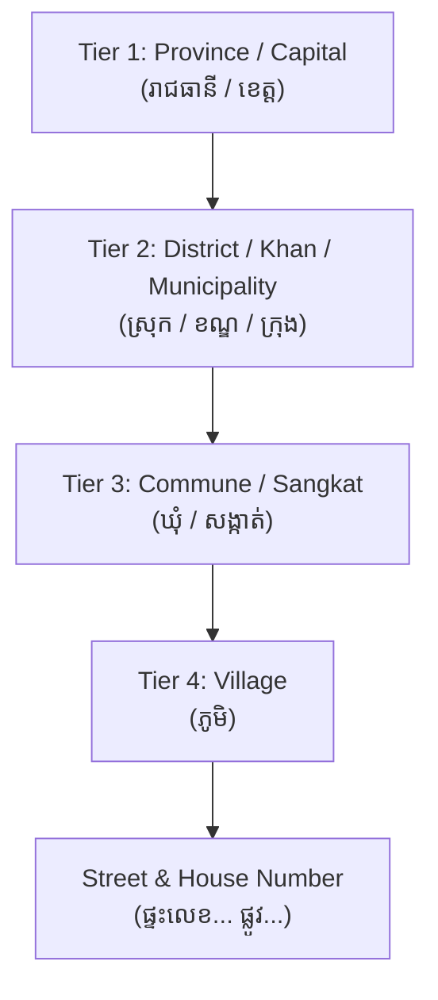

# Cambodian Administrative Divisions & Address Architecture

This reference provides technical specifications, standard data models, and internationalization guidelines for handling Cambodian postal addresses, geographic hierarchies, and administrative divisions in web and mobile applications.

---

## 1. The 4-Tier Administrative Hierarchy

In the Kingdom of Cambodia, civilian administration follows a strictly defined 4-tier hierarchical structure established by the Ministry of Interior (MoI) and the National Committee for Sub-National Democratic Development (NCDD):



### Administrative Types Explained:
1. **Tier 1: Province vs. Capital (រាជធានី-ខេត្ត)**
   - **Capital (រាជធានី - *Reach Theani*):** Phnom Penh is Cambodia's sole autonomous municipality/capital city.
   - **Provinces (ខេត្ត - *Khet*):** There are 24 regional provinces.
   - Total Tier 1 divisions: **25**.
2. **Tier 2: District vs. Khan vs. Municipality (ស្រុក / ខណ្ឌ / ក្រុង)**
   - **Khan (ខណ្ឌ):** Subdivisions inside Phnom Penh (e.g. Khan Daun Penh, Khan Tuol Kouk, Khan Chamkarmon).
   - **Municipality (ក្រុង - *Krong*):** Provincial cities / urban centers (e.g. Krong Siem Reap, Krong Battambang, Krong Sihanoukville).
   - **District (ស្រុក - *Srok*):** Rural or semi-rural subdivisions in the 24 provinces.
3. **Tier 3: Sangkat vs. Commune (សង្កាត់ / ឃុំ)**
   - **Sangkat (សង្កាត់):** Urban quarter / subdivision used inside Khans (Phnom Penh) and Krongs (provincial cities).
   - **Commune (ឃុំ - *Khum*):** Rural collective of villages used inside rural Sroks.
4. **Tier 4: Village (ភូមិ - *Phum*)**
   - The smallest recognized local administrative unit. In dense urban Phnom Penh, village names are often omitted in favor of street and building numbers; in provincial and rural areas, the Village (*Phum*) is essential for physical mail and parcel delivery.

---

## 2. Complete List of 25 Capital & Provinces (ISO 3166-2:KH)

This standardized table provides official bilingual naming and ISO 3166-2:KH codes:

| ISO Code | English Name | Khmer Name | Admin Type | Primary City / Seat |
| :--- | :--- | :--- | :--- | :--- |
| **KH-12** | Phnom Penh | ភ្នំពេញ | Autonomous Municipality (រាជធានី) | Phnom Penh |
| **KH-1** | Banteay Meanchey | បន្ទាយមានជ័យ | Province (ខេត្ត) | Serei Saophoan |
| **KH-2** | Battambang | បាត់ដំបង | Province (ខេត្ត) | Battambang |
| **KH-3** | Kampong Cham | កំពង់ចាម | Province (ខេត្ត) | Kampong Cham |
| **KH-4** | Kampong Chhnang | កំពង់ឆ្នាំង | Province (ខេត្ត) | Kampong Chhnang |
| **KH-5** | Kampong Speu | កំពង់ស្ពឺ | Province (ខេត្ត) | Chbar Mon |
| **KH-6** | Kampong Thom | កំពង់ធំ | Province (ខេត្ត) | Stung Saen |
| **KH-7** | Kampot | កំពត | Province (ខេត្ត) | Kampot |
| **KH-8** | Kandal | កណ្តាល | Province (ខេត្ត) | Ta Khmau |
| **KH-9** | Koh Kong | កោះកុង | Province (ខេត្ត) | Khemarak Phoumin |
| **KH-10** | Kratie | ក្រចេះ | Province (ខេត្ត) | Kratie |
| **KH-11** | Mondulkiri | មណ្ឌលគិរី | Province (ខេត្ត) | Senmonorom |
| **KH-13** | Preah Vihear | ព្រះវិហារ | Province (ខេត្ត) | Tbeng Meanchey |
| **KH-14** | Prey Veng | ព្រៃវែង | Province (ខេត្ត) | Prey Veng |
| **KH-15** | Pursat | ពោធិ៍សាត់ | Province (ខេត្ត) | Pursat |
| **KH-16** | Ratanakiri | រតនគិរី | Province (ខេត្ត) | Banlung |
| **KH-17** | Siem Reap | សៀមរាប | Province (ខេត្ត) | Siem Reap |
| **KH-18** | Preah Sihanouk | ព្រះសីហនុ | Province (ខេត្ត) | Sihanoukville |
| **KH-19** | Stung Treng | ស្ទឹងត្រែង | Province (ខេត្ត) | Stung Treng |
| **KH-20** | Svay Rieng | ស្វាយរៀង | Province (ខេត្ត) | Svay Rieng |
| **KH-21** | Takeo | តាកែវ | Province (ខេត្ត) | Doun Kaev |
| **KH-22** | Oddar Meanchey | ឧត្តរមានជ័យ | Province (ខេត្ត) | Samraong |
| **KH-23** | Kep | កែប | Province (ខេត្ត) | Kep |
| **KH-24** | Pailin | ប៉ៃលិន | Province (ខេត្ត) | Pailin |
| **KH-25** | Tboung Khmum | ត្បូងឃ្មុំ | Province (ខេត្ត) | Suong |

---

## 3. Cambodian Address Formatting Standards

### 3.1 Domestic Khmer Ordering
In Khmer, addresses follow a **Smallest $\rightarrow$ Largest** or **Specific $\rightarrow$ General** order:

$$\text{ផ្ទះលេខ (House)} \rightarrow \text{ផ្លូវ (Street)} \rightarrow \text{ភូមិ (Village)} \rightarrow \text{សង្កាត់/ឃុំ (Sangkat/Khum)} \rightarrow \text{ខណ្ឌ/ស្រុក/ក្រុង (Khan/Srok/Krong)} \rightarrow \text{រាជធានី/ខេត្ត (Province)}$$

**Example 1 (Urban Phnom Penh):**
> ផ្ទះលេខ ១២A, ផ្លូវ ២០០, សង្កាត់បឹងរាំង, ខណ្ឌដូនពេញ, រាជធានីភ្នំពេញ

**Example 2 (Provincial Siem Reap):**
> ផ្ទះលេខ ៤៥, ផ្លូវ ៦, ភូមិវត្តបូព៌, សង្កាត់សាលាកំរើក, ក្រុងសៀមរាប, ខេត្តសៀមរាប

### 3.2 International English Ordering
For international postal shipments and English-language invoices:
> No. 12A, St. 200, Sangkat Boeng Reang, Khan Daun Penh, Phnom Penh 120211, Cambodia.

### 3.3 Postal Codes (MPTC Standard)
Cambodia's Ministry of Post and Telecommunications (MPTC) standardizes postal codes as 5- or 6-digit numeric sequences:
- **Phnom Penh central:** `12000` (General Postal Office / Wat Phnom area).
- **Format:** 2 digits province code + 2 digits district/khan + 1-2 digits commune/delivery zone.
- *UX Recommendation:* In e-commerce checkouts for Cambodia, **never make Postal Code a mandatory blocking field**. Most domestic couriers (J&T, Virak Buntham, GrabExpress) rely on Phone Number + Sangkat + Khan + Landmarks rather than postal codes.

---

## 4. TypeScript Address Data Model & Validation Schema

```typescript
export interface AdministrativeDivision {
  code: string;           // ISO 3166-2:KH (e.g. "KH-12")
  nameKh: string;         // e.g. "រាជធានីភ្នំពេញ"
  nameEn: string;         // e.g. "Phnom Penh"
  type: "municipality" | "province";
}

export interface CambodianAddress {
  houseNumber?: string;   // e.g. "12A" or "ផ្ទះលេខ ១២A"
  streetName: string;     // e.g. "St. 200" or "ផ្លូវ ២០០"
  village?: string;       // e.g. "ភូមិវត្តបូព៌" (optional in city)
  sangkatOrKhum: string;  // e.g. "សង្កាត់បឹងរាំង"
  districtOrKhan: string; // e.g. "ខណ្ឌដូនពេញ"
  provinceOrCity: string; // e.g. "រាជធានីភ្នំពេញ" (or ISO code "KH-12")
  postalCode?: string;    // Optional 5-6 digit code
  landmarkNotes?: string; // Critical for local delivery (e.g. "ជិតផ្សារកណ្តាល")
}
```

### Form Design Best Practices for Cambodia:
1. **Provide Cascading Dropdowns:** Start with Province/City $\rightarrow$ Filter District/Khan $\rightarrow$ Filter Sangkat/Commune.
2. **Include Landmark / Directions Field:** "Near Central Market", "Opposite Calmette Hospital", etc. Domestic couriers rely heavily on visual landmarks.
3. **Primary Phone is the Delivery Anchor:** In Cambodia, couriers always phone the customer before delivery. Ensure the phone number input validates standard Cambodian formats (`0xx xxx xxx` or `0xx xxx xxxx`).


> [!TIP]
> A machine-readable JSON dataset containing all 25 divisions is available at [`data/provinces.json`](../data/provinces.json).


> [!NOTE]
> District-level datasets are available at [`data/phnom_penh_districts.json`](../data/phnom_penh_districts.json), [`data/siem_reap_districts.json`](../data/siem_reap_districts.json), and [`data/battambang_districts.json`](../data/battambang_districts.json).
