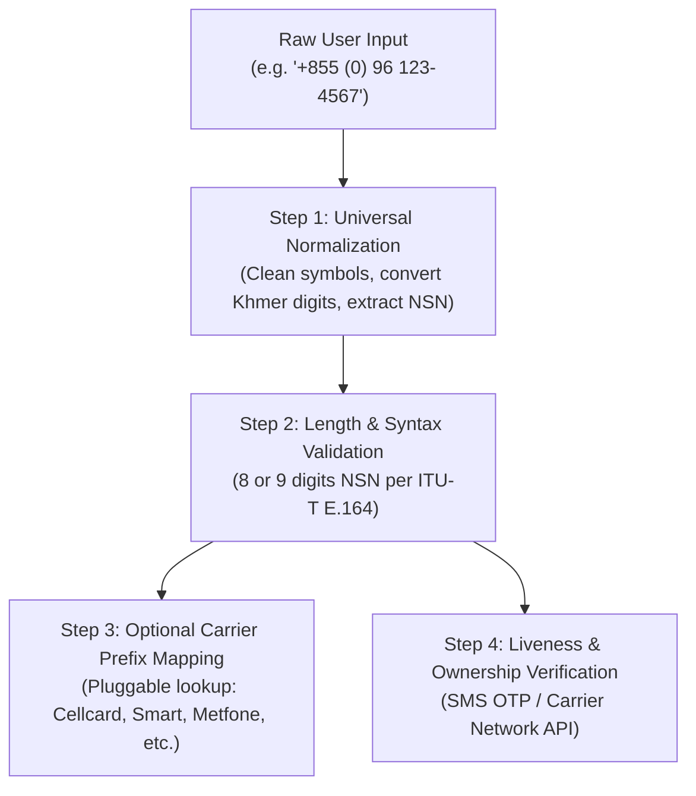

# Cambodia Regional Formatting & Internationalization Guide

This reference provides technical specifications, regulatory standards, and code patterns for Cambodian phone-number handling, dual-currency formatting (USD and KHR), and bilingual (Khmer/English) software internationalization.

---

## 1. Cambodian Phone Numbers

### 1.1 Regulatory Authority and Primary Sources
- **National Regulatory Body:** Telecommunication Regulator of Cambodia (TRC) — [https://trc.gov.kh](https://trc.gov.kh) (Direct resource: *Mobile Service Providers & National Numbering Plan*, verified October 2026).
- **Ministry:** Ministry of Post and Telecommunications (MPTC) — [https://mptc.gov.kh](https://mptc.gov.kh).
- **International Standard:** ITU-T Recommendation E.164 (Cambodia National Numbering Plan), maintained via the ITU International Numbering Resources portal: [https://www.itu.int/en/ITU-T/inr/nnp/Pages/default.aspx](https://www.itu.int/en/ITU-T/inr/nnp/Pages/default.aspx).

### 1.2 Separation of Normalization Algorithm vs. Prefix Lookup Data

To build maintainable systems, agents and developers must separate:
1. **The Normalization Algorithm (Stable):** Strips formatting symbols, normalizes Khmer digits, extracts country/trunk prefixes, and validates structural length (NSN). This algorithm rarely changes.
2. **Carrier Prefix Lookup Data (Volatile):** Carrier prefix assignments (`012` Cellcard, `096` Smart, `088` Metfone, etc.) are subject to MPTC/TRC regulatory updates, operator mergers, and Mobile Number Portability (MNP). Normalization must never fail on unknown prefixes simply because a prefix list is outdated.



### 1.3 National Numbering Architecture & Length Variations

Under ITU-T Recommendation E.164 and the TRC plan, Cambodia uses a closed numbering plan:
- **Country Calling Code:** `+855` (allocated by ITU-T).
- **Domestic Trunk Prefix:** `0` (used when dialing domestically; dropped in international E.164 format).
- **National Significant Number (NSN) Length:** **8 or 9 digits** depending on operator allocation.

#### Length Breakdown:
1. **Standard 8-digit NSN (9 digits domestic with `0`):**
   - Typically 2-digit operator code + 6-digit subscriber number (e.g. `012 xxx xxx`).
   - Domestic dialing: `012 345 678` (9 digits).
   - International E.164: `+855 12 345 678` (11 characters).
2. **Extended 9-digit NSN (10 digits domestic with `0`):**
   - Typically 2- or 3-digit operator code + 7-digit subscriber number (marked with `*` in TRC plan, e.g. `096 xxx xxxx`, `088 xxx xxxx`, `076 xxx xxxx`).
   - Domestic dialing: `096 123 4567` (10 digits).
   - International E.164: `+855 96 123 4567` (12 characters).
3. **Geographic Fixed Lines (Landlines):**
   - Geographic area code (e.g. `023` for Phnom Penh, `063` for Siem Reap, `053` for Battambang) followed by 5 to 7 subscriber digits (total 8 or 9 digits domestic).

### 1.4 Current Mobile Network Operator Prefixes (TRC Baseline, October 2026)
> [!NOTE]
> This table represents the operational baseline documented by the TRC as of October 2026. Use this for carrier routing or informational labeling, but do not block user registration if a newly assigned prefix is encountered.

| Operator | Brand | Domestic Prefixes | NSN Length |
| :--- | :--- | :--- | :--- |
| **CamGSM Plc.** | Cellcard | `011`, `012`, `014`, `017`, `061`, `077`, `078`, `085`, `089`, `092`, `095`, `099`<br>`076`* | 8 digits<br>9 digits (`*`) |
| **Smart Axiata Co., Ltd.** | Smart | `010`, `015`, `016`, `069`, `070`, `081`, `086`, `087`, `093`, `098`<br>`096`* | 8 digits<br>9 digits (`*`) |
| **Viettel (Cambodia) Pte., Ltd.** | Metfone | `060`, `066`, `067`, `068`, `090`<br>`031`*, `071`*, `088`*, `097`* | 8 digits<br>9 digits (`*`) |
| **South East Asia Telecom Co., Ltd.** | Seatel | `018`* | 9 digits (`*`) |

### 1.5 Robust TypeScript Normalization Implementation

```typescript
export interface PhoneNormalizationResult {
  raw: string;
  nsn: string | null;                  // National Significant Number (8 or 9 digits)
  normalizedE164: string | null;       // +855...
  normalizedDomestic: string | null;   // 0...
  isValidSyntax: boolean;
  lengthCategory: "8_digits" | "9_digits" | "invalid";
  requiresOtpVerification: true;      // Explicit boundary flag
  isActiveSim: false;                  // Syntax check NEVER confirms active status
  error?: string;
}

export function normalizeCambodianPhone(input: string): PhoneNormalizationResult {
  const result: PhoneNormalizationResult = {
    raw: input,
    nsn: null,
    normalizedE164: null,
    normalizedDomestic: null,
    isValidSyntax: false,
    lengthCategory: "invalid",
    requiresOtpVerification: true,
    isActiveSim: false,
  };

  if (!input || typeof input !== "string") {
    result.error = "Input is empty or invalid.";
    return result;
  }

  // 1. Remove whitespace, hyphens, brackets, and dots
  let cleaned = input.replace(/[\s\-\(\)\.]+/g, "");

  // 2. Convert Khmer numerals (០-៩) to ASCII digits (0-9)
  cleaned = cleaned.replace(/[\u17E0-\u17E9]/g, (match) => {
    return String(match.charCodeAt(0) - 0x17E0);
  });

  // 3. Extract country code and trunk prefix
  let nationalNumber = "";
  if (cleaned.startsWith("+855")) {
    nationalNumber = cleaned.slice(4);
  } else if (cleaned.startsWith("00855")) {
    nationalNumber = cleaned.slice(5);
  } else if (cleaned.startsWith("855")) {
    nationalNumber = cleaned.slice(3);
  } else if (cleaned.startsWith("0")) {
    nationalNumber = cleaned.slice(1);
  } else {
    nationalNumber = cleaned;
  }

  // Handle accidental redundant zero after country code (e.g. '+855012...')
  if (nationalNumber.startsWith("0")) {
    nationalNumber = nationalNumber.slice(1);
  }

  // 4. Verify all remaining characters are numeric
  if (!/^\d+$/.test(nationalNumber)) {
    result.error = "Phone number contains non-numeric characters.";
    return result;
  }

  // 5. Length verification: Cambodian NSN is 8 or 9 digits
  if (nationalNumber.length === 8) {
    result.lengthCategory = "8_digits";
  } else if (nationalNumber.length === 9) {
    result.lengthCategory = "9_digits";
  } else {
    result.error = `Invalid NSN length: ${nationalNumber.length} digits (expected 8 or 9 digits).`;
    return result;
  }

  result.nsn = nationalNumber;
  result.normalizedE164 = `+855${nationalNumber}`;
  result.normalizedDomestic = `0${nationalNumber}`;
  result.isValidSyntax = true;

  return result;
}
```

> [!CRITICAL]
> **Syntax Validation vs. Active Liveness:**
> Syntax validation only verifies structural format and length. It **NEVER** proves that a telephone number is active, assigned to a valid SIM, or in the possession of the user. Verifying active status requires an out-of-band challenge (SMS OTP) or telecommunications carrier lookup.

---

## 2. Currency Formatting: USD and KHR

Cambodia is an officially dual-currency economy. Both the **Cambodian Riel (KHR)** and the **United States Dollar (USD)** circulate simultaneously in daily commerce, retail, banking, and e-commerce.

### 2.1 Currency Comparison & Runtime Defaults

| Attribute | Cambodian Riel (KHR) | United States Dollar (USD) |
| :--- | :--- | :--- |
| **ISO 4217 Currency Code** | `KHR` | `USD` |
| **Currency Symbol** | `៛` (`U+17DB`) | `$` |
| **ISO 4217 Minor Units** | **2** (Formal ISO standard specification) | **2** (Cents) |
| **Cash Circulation Reality** | **0 decimals** (100 ៛ smallest banknote; no coins/cents) | **2 decimals** (Cents in circulation) |
| **`Intl.NumberFormat` Default** | **2 decimal places (`25,000.00៛`)** in V8/Node/browsers! | **2 decimal places (`$25.00`)** |
| **Consumer Display Convention** | **Whole Riel (`25,000 ៛`)** | Standard 2 decimals (`$25.00`) |

### 2.2 Critical Audit: Do Not Assume 0 Decimals by Default

> [!WARNING]
> In standard ECMAScript / ICU implementations of `Intl.NumberFormat`, calling:
> ```javascript
> new Intl.NumberFormat('km-KH', { style: 'currency', currency: 'KHR' }).format(1000);
> ```
> **produces `1,000.00៛`**, because ICU relies on the ISO 4217 table where KHR has minor units = 2.
>
> In everyday Cambodian retail and consumer applications, whole-riel prices without `.00` are overwhelmingly expected. Therefore, developers **MUST explicitly configure `{ minimumFractionDigits: 0, maximumFractionDigits: 0 }`** to achieve whole-riel display.

### 2.3 Formatting vs. Conversion

> [!CRITICAL]
> **Currency formatting is NOT currency conversion.**
> Never convert USD amounts to KHR (or vice versa) without an explicit, verifiable exchange rate provided by the user or fetched from an official source (such as the National Bank of Cambodia - NBC: [https://www.nbc.gov.kh](https://www.nbc.gov.kh)). Never assume a fixed 4,000 KHR or 4,100 KHR rate silently in production code.

### 2.4 Production-Quality Currency Formatting Utilities

```typescript
export interface FormatCurrencyOptions {
  locale?: "km-KH" | "en-US" | "en-KH";
  numberingSystem?: "latn" | "khmr"; // 'latn' = 0-9, 'khmr' = ០-៩
  wholeRiel?: boolean;               // Default true: formats whole riel without .00
}

/**
 * Format Cambodian Riel (KHR)
 * Explicitly configures whole-riel display (0 decimals) or ISO fractional display.
 */
export function formatKHR(amount: number, options: FormatCurrencyOptions = {}): string {
  const { locale = "km-KH", numberingSystem = "latn", wholeRiel = true } = options;

  const fractionDigits = wholeRiel
    ? { minimumFractionDigits: 0, maximumFractionDigits: 0 }
    : { minimumFractionDigits: 2, maximumFractionDigits: 2 };

  // Note: Most fintech apps (Bakong, ABA) default to 'latn' numerals for clarity
  const formatter = new Intl.NumberFormat(`${locale}-u-nu-${numberingSystem}`, {
    style: "currency",
    currency: "KHR",
    ...fractionDigits,
  });

  return formatter.format(amount);
}

/**
 * Format US Dollar (USD)
 * Standard: 2 decimal places with half-up rounding.
 */
export function formatUSD(amount: number, options: FormatCurrencyOptions = {}): string {
  const { locale = "en-US", numberingSystem = "latn" } = options;

  const formatter = new Intl.NumberFormat(`${locale}-u-nu-${numberingSystem}`, {
    style: "currency",
    currency: "USD",
    minimumFractionDigits: 2,
    maximumFractionDigits: 2,
  });

  return formatter.format(amount);
}
```

#### Verified Outputs:
- **Whole Riel (standard):** `formatKHR(25000)` $\rightarrow$ `"25,000៛"`
- **Zero Riel:** `formatKHR(0)` $\rightarrow$ `"0៛"`
- **Negative Riel:** `formatKHR(-25000)` $\rightarrow$ `"-25,000៛"`
- **Rounding fractional riel:** `formatKHR(25000.75)` $\rightarrow$ `"25,001៛"` (rounds half-expand)
- **Large Riel values:** `formatKHR(1234567890)` $\rightarrow$ `"1,234,567,890៛"`
- **Khmer Numerals:** `formatKHR(25000, { numberingSystem: "khmr" })` $\rightarrow$ `"២៥.០០០៛"` (ICU uses period separators with Khmer digits)
- **USD standard:** `formatUSD(12.5)` $\rightarrow$ `"$12.50"`
- **USD rounding:** `formatUSD(12.345)` $\rightarrow$ `"$12.35"`
- **USD large values:** `formatUSD(1000000)` $\rightarrow$ `"$1,000,000.00"`

---

## 3. Bilingual (Khmer / English) Internationalization

### 3.1 Pluralization in Khmer
Unlike English, Khmer does not inflect nouns for singular vs. plural:
- English: `1 item`, `5 items` (inflected with `-s`)
- Khmer: `ទំនិញ ១`, `ទំនិញ ៥` (base noun remains unchanged)

When configuring i18n libraries (e.g. `i18next`, `react-intl`, `vue-i18n`), Khmer only requires the `other` plural form:

```json
{
  "cart_items_count_one": "{{count}} item",
  "cart_items_count_other": "{{count}} items",
  "cart_items_count_km": "ទំនិញ {{count}}"
}
```

### 3.2 Locale Switching & Fallback Hierarchy
1. Store locale preference explicitly (e.g., `localStorage.getItem('user_locale')` or user profile database record).
2. Default hierarchy:
   $$\text{User Preference} \rightarrow \text{Browser Navigator Language} \rightarrow \text{Khmer (km)} \rightarrow \text{English (en) Fallback}$$
3. When a Khmer translation key is missing during development, fall back gracefully to the English string rather than crashing or showing raw empty keys (`undefined`).

---

## 4. Cambodian Calendar, Dates, and Time Formatting

### 4.1 Solar Calendar & Month Names
Standard digital products in Cambodia use the **Gregorian solar calendar**, with month names translated into Khmer.

| Month | Khmer Name | Standard Abbreviation | Days |
| :--- | :--- | :--- | :--- |
| **January** | មករា (*Makara*) | មករា | 31 |
| **February** | កុម្ភៈ (*Kumpheak*) | កុម្ភៈ | 28/29 |
| **March** | មីនា (*Meena*) | មីនា | 31 |
| **April** | មេសា (*Mesa*) | មេសា | 30 |
| **May** | ឧសភា (*Ousaphea*) | ឧសភា | 31 |
| **June** | មិថុនា (*Mithona*) | មិថុនា | 30 |
| **July** | កក្កដា (*Kakada*) | កក្កដា | 31 |
| **August** | សីហា (*Seiha*) | សីហា | 31 |
| **September** | កញ្ញា (*Kanh Nha*) | កញ្ញា | 30 |
| **October** | តុលា (*Tola*) | តុលា | 31 |
| **November** | វិច្ឆិកា (*Vichika*) | វិច្ឆិកា | 30 |
| **December** | ធ្នូ (*Thnou*) | ធ្នូ | 31 |

### 4.2 Days of the Week

| Day | Khmer Name | Common Short Form |
| :--- | :--- | :--- |
| **Monday** | ច័ន្ទ (*Chan*) | ច |
| **Tuesday** | អង្គារ (*Angkea*) | អ |
| **Wednesday** | ពុធ (*Puth*) | ព |
| **Thursday** | ព្រហស្បតិ៍ (*Prohoah*) | ព្រ |
| **Friday** | សុក្រ (*Sok*) | សុ |
| **Saturday** | សៅរ៍ (*Sao*) | ស |
| **Sunday** | អាទិត្យ (*Atdit*) | អា |

### 4.3 Buddhist Era (BE — ពុទ្ធសករាជ / ព.ស.)
Cambodia observes both the Christian Era (CE/AD) and the **Buddhist Era (BE)**:
- **Conversion Formula:**
  $$\text{Year (BE)} = \text{Year (CE)} + 543$$
  *(Example: $2026\text{ CE} + 543 = 2569\text{ BE}$)*
- **Usage Rules in Digital Products:**
  - **Commercial, Fintech, & E-commerce UI:** Standard Gregorian year ($2026$) with Latin or Khmer numerals is standard.
  - **Official Legal, Government, & Traditional Documents:** Buddhist Era is displayed prominently:
    `ថ្ងៃទី១៩ ខែតុលា ឆ្នាំ២០២៦ (ព.ស. ២៥៦៩)`

### 4.4 Date Formatting Standards
- **Short Numeric Format:** `DD/MM/YYYY` (Day precedes month; e.g. `19/10/2026`). Never use US-style `MM/DD/YYYY`.
- **Long Localized Format:** `ថ្ងៃទីD ខែ[Month] ឆ្នាំYYYY` (e.g. `ថ្ងៃទី១៩ ខែតុលា ឆ្នាំ២០២៦` or `ថ្ងៃទី 19 ខែតុលា ឆ្នាំ 2026`).

### 4.5 Time Conventions & Day Periods
Cambodia operates in Indochina Time (**ICT — UTC+07:00**), with no Daylight Saving Time (DST).

- **12-Hour Period Qualifiers:**
  - **ព្រឹក (*Pruk*):** Morning / AM ($00:00 - 11:59$)
  - **រសៀល (*Rosiel*):** Early Afternoon ($12:00 - 16:59$)
  - **ល្ងាច (*Lngeach*):** Late Afternoon / Evening ($17:00 - 18:59$)
  - **យប់ (*Yob*):** Night ($19:00 - 23:59$)
- **Display Examples:**
  - `ម៉ោង ៨:៣០ ព្រឹក` (8:30 AM)
  - `ម៉ោង ២:១៥ រសៀល` (2:15 PM)
  - `ម៉ោង ៦:៤៥ ល្ងាច` (6:45 PM)
  - `ម៉ោង ៩:០០ យប់` (9:00 PM)

### 4.6 Relative Time Formatting
In notifications, social feeds, and transaction records:

```typescript
export function formatKhmerRelativeTime(diffSeconds: number): string {
  if (diffSeconds < 60) return "មុននេះបន្តិច"; // Just now
  const mins = Math.floor(diffSeconds / 60);
  if (mins < 60) return `${mins} នាទីមុន`; // X minutes ago
  const hours = Math.floor(mins / 60);
  if (hours < 24) return `${hours} ម៉ោងមុន`; // X hours ago
  const days = Math.floor(hours / 24);
  if (days === 1) return "ម្សិលមិញ"; // Yesterday
  if (days < 7) return `${days} ថ្ងៃមុន`; // X days ago
  return `${Math.floor(days / 7)} សប្តាហ៍មុន`; // X weeks ago
}
```

---

## 5. National Payment Standards: Bakong & KHQR

### 5.1 The Bakong & KHQR Ecosystem
**Bakong** is the national payment and financial switch developed by the **National Bank of Cambodia (NBC)**. Its universal QR code standard, **KHQR** (compliant with EMVCo QR specifications), is the universal payment rail across all commercial banks, microfinance institutions (MFIs), and payment service providers in Cambodia.

### 5.2 Key Internationalization & UX Rules for KHQR Displays
1. **Explicit Currency Display:**
   - KHQR codes are currency-specific: an invoice QR is issued in either **KHR (Code 116)** or **USD (Code 840)**.
   - Always display the currency code and symbol prominently alongside the merchant QR:
     - **For KHR:** `25,000 ៛` (whole-riel format).
     - **For USD:** `$6.25` (2 decimal places).
2. **Account Identifier Formats:**
   - Account numbers in Bakong are typically formatted as:
     - An **E.164 phone number** (e.g. `+855 12 345 678` or `012 345 678`).
     - A **Bakong Account ID** in the format `account_name@bank_domain` (e.g. `sokha_chhorn@acleda`).
3. **Bilingual Payment Receipt Microcopy:**

| English Term | Khmer UI Term | Usage |
| :--- | :--- | :--- |
| **Scan to Pay** | ស្កេនដើម្បីទូទាត់ | Call-to-action under QR code |
| **Merchant Name** | ឈ្មោះអាជីវករ | Header above QR code |
| **Account Name** | ឈ្មោះគណនី | Beneficiary account holder |
| **Amount** | ចំនួនទឹកប្រាក់ | Transaction billing amount |
| **Transaction ID** | លេខកូដប្រតិបត្តិការ | Audit tracking code |
| **Payment Status: Success** | ស្ថានភាព៖ ជោគជ័យ | Completed receipt badge |
| **Payment Status: Pending** | ស្ថានភាព៖ កំពុងដំណើរការ | In-flight authorization badge |
| **Payment Status: Failed** | ស្ថានភាព៖ មិនជោគជ័យ | Terminal decline badge |

---

## 6. National Identification & Vehicle Registration Standards

### 6.1 Cambodian National ID Cards (អត្តសញ្ញាណប័ណ្ណសញ្ជាតិខ្មែរ)
- **Authority:** General Department of Identification (GDI), Ministry of Interior ([https://gdi.gov.kh](https://gdi.gov.kh)).
- **Format Architecture:**
  - **9-Digit Format (Legacy):** Issued prior to nationwide smart biometric rollouts. Still legal tender throughout Cambodia.
  - **10-Digit Format (Smart Biometric):** Standard chip card format featuring electronic fingerprint data.
  - **Province Encoding:** The first 2 digits correspond to the birth/registration provincial code (e.g. `01` Banteay Meanchey, `12` Phnom Penh).
  - **Script Support:** User inputs frequently contain Khmer digits (`០-៩`), ASCII digits (`0-9`), hyphens, or whitespace. All e-KYC forms must normalize inputs before database storage.

```python
from scripts.khmer_utils import validate_cambodian_id

# Normalizes both Khmer and Arabic digits seamlessly
res = validate_cambodian_id("១២-០១២៣-៤៥៦៧")
# returns: {'is_valid': True, 'id_type': 'smart_id', 'normalized': '1201234567', 'province_code': '12'}
```

### 6.2 Cambodian Vehicle License Plates (ក្រសួងសាធារណការ និងដឹកជញ្ជូន - MPWT)
- **Authority:** Ministry of Public Works and Transport ([https://mpwt.gov.kh](https://mpwt.gov.kh)).
- **Numbering Architecture:**
  - **Automobiles / Passenger Cars (Class 2):** `[City/Province] 2[A-Z]{1-3}-[0-9]{4}` (e.g., `ភ្នំពេញ 2BC-1234` or `Phnom Penh 2BC-1234`).
  - **Motorcycles (Class 1):** `[City/Province] 1[A-Z]{1-3}-[0-9]{4}` (e.g., `1FD-5678`).
  - **Commercial Freight (Class 3 & 4):** `[City/Province] 3A-1234` or `4A-1234`.
  - **Official State (រដ្ឋ):** `រដ្ឋ [Dept] [Series]-[Number]`.
  - **National Police (ន.ប):** `ន.ប [Series]-[Number]`.
  - **Royal Cambodian Armed Forces (ខ.ម):** `ខ.ម [Unit] [Series]-[Number]`.

---

> [!TIP]
> **Deep-Dive Specialized References:**
> - For full EMVCo TLV tag mappings, payload structure, and CRC16 checksum algorithms, see [Khmer Fintech & Bakong KHQR](./khmer-fintech-and-khqr.md).
> - For Cambodian administrative hierarchy (Provinces, Khans, Sangkats, Villages) and address forms, see [Cambodian Administrative Divisions](./cambodia-administrative-divisions.md).
> - For Khmer alphabetical dictionary sorting and number-to-words currency spellouts, see [Khmer Collation & Number-to-Words](./khmer-collation-and-number-words.md).


