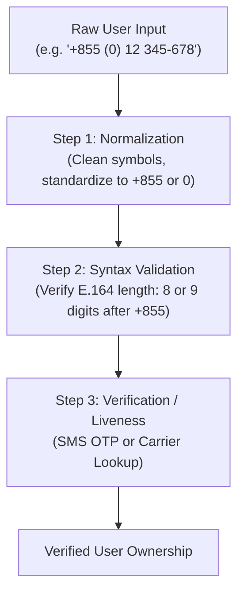

# Cambodia Regional Formatting & Internationalization Guide

This reference provides technical specifications, regulatory standards, and code patterns for Cambodian phone-number handling, dual-currency formatting (USD and KHR), and bilingual (Khmer/English) software internationalization.

---

## 1. Cambodian Phone Numbers

### 1.1 Regulatory Authority and Primary Sources
- **Regulatory Body:** Telecommunication Regulator of Cambodia (TRC) — [https://trc.gov.kh](https://trc.gov.kh) (Accessed October 2026).
- **Ministry:** Ministry of Post and Telecommunications (MPTC) — [https://mptc.gov.kh](https://mptc.gov.kh).
- **International Standard:** ITU-T Recommendation E.164 National Numbering Plan for Cambodia.

### 1.2 Stable vs. Mutable Concepts

| Category | Concept | Stability Status | Rule & Guidance |
| :--- | :--- | :--- | :--- |
| **Country Calling Code** | `+855` | **Stable** | Allocated by ITU-T. Never changes without international treaty. |
| **Domestic Trunk Prefix** | `0` | **Stable** | Required for domestic direct dialing within Cambodia. Dropped in E.164. |
| **National Significant Number (NSN)** | 8 or 9 digits | **Stable** | Length of subscriber number after dropping leading trunk `0`. |
| **Operator Prefix Allocations** | e.g. `012`, `096` | **Subject to Change** | Regulated by TRC decrees. Prefixes can be reassigned or consolidated. |
| **Number Ownership & Active Status** | Real-time SIM | **Dynamic** | Syntax validation never verifies active status. Requires SMS OTP or carrier API. |

### 1.3 National Numbering Architecture

1. **Domestic Dialing Format:** `0` + `[Area/Mobile Prefix]` + `[Subscriber Number]`
   - Standard 6-digit subscriber: Total **9 digits** (e.g. `012 345 678`)
   - 7-digit subscriber (marked with `*`): Total **10 digits** (e.g. `096 123 4567`)
2. **International E.164 Format:** `+855` + `[Area/Mobile Prefix without 0]` + `[Subscriber Number]`
   - Standard 6-digit subscriber: Total **11 characters** (e.g. `+85512345678`)
   - 7-digit subscriber: Total **12 characters** (e.g. `+855961234567`)

### 1.4 Operator Prefixes (Reference Baseline: TRC National Plan)
- **Cellcard (CamGSM):** `011`, `012`, `014`, `017`, `061`, `077`, `078`, `085`, `089`, `092`, `095`, `099`, `076`*
- **Smart Axiata:** `010`, `015`, `016`, `069`, `070`, `081`, `086`, `087`, `093`, `098`, `096`*
- **Metfone (Viettel):** `060`, `066`, `067`, `068`, `090`, `031`*, `071`*, `088`*, `097`*
- **SEATEL (Southeast Asia Telecom):** `018`*
- **Geographic Fixed Lines (Landline):** `023` (Phnom Penh), `063` (Siem Reap), `053` (Battambang), `032` (Takeo), `033` (Kampot), `034` (Preah Sihanouk), `042` (Kampong Cham), etc.

### 1.5 Three-Tier Input Processing Pipeline



#### TypeScript Implementation:
```typescript
export interface PhoneNormalizationResult {
  raw: string;
  normalizedE164: string | null;
  normalizedDomestic: string | null;
  isValidSyntax: boolean;
  isMobileCandidate: boolean;
  error?: string;
}

export function parseCambodianPhone(input: string): PhoneNormalizationResult {
  const result: PhoneNormalizationResult = {
    raw: input,
    normalizedE164: null,
    normalizedDomestic: null,
    isValidSyntax: false,
    isMobileCandidate: false,
  };

  if (!input || typeof input !== "string") {
    result.error = "Input is empty or invalid.";
    return result;
  }

  // 1. Remove whitespace, hyphens, brackets, dots
  let cleaned = input.replace(/[\s\-\(\)\.]+/g, "");

  // Convert Khmer numerals (០-៩) to ASCII digits (0-9) if present
  cleaned = cleaned.replace(/[\u17E0-\u17E9]/g, (match) => {
    return String(match.charCodeAt(0) - 0x17E0);
  });

  // 2. Identify and strip country code
  let nationalNumber = "";
  if (cleaned.startsWith("+855")) {
    nationalNumber = cleaned.slice(4);
  } else if (cleaned.startsWith("00855")) {
    nationalNumber = cleaned.slice(5);
  } else if (cleaned.startsWith("855")) {
    nationalNumber = cleaned.slice(3);
  } else if (cleaned.startsWith("0")) {
    nationalNumber = cleaned.slice(1);
  } else {
    // Treat as raw national number without leading 0
    nationalNumber = cleaned;
  }

  // Handle case where user entered '+855012...' (erroneous leading zero after country code)
  if (nationalNumber.startsWith("0")) {
    nationalNumber = nationalNumber.slice(1);
  }

  // 3. Length check: Cambodian NSN is 8 or 9 digits
  if (!/^\d{8,9}$/.test(nationalNumber)) {
    result.error = "Invalid length. Cambodian numbers must have 8 or 9 digits after country code.";
    return result;
  }

  result.normalizedE164 = `+855${nationalNumber}`;
  result.normalizedDomestic = `0${nationalNumber}`;
  result.isValidSyntax = true;

  // Basic mobile check: mobile prefixes typically start with 1, 6, 7, 8, 9, or 3
  const firstDigit = nationalNumber.charAt(0);
  result.isMobileCandidate = ["1", "3", "6", "7", "8", "9"].includes(firstDigit);

  return result;
}
```

> [!WARNING]
> Never claim a phone number is "verified" or "active" merely because it matches syntactic regular expressions. Format validation only checks structure; active status requires external verification (e.g., SMS OTP).

---

## 2. Currency Formatting: USD and KHR

Cambodia is an officially dual-currency economy. Both the **Cambodian Riel (KHR)** and the **United States Dollar (USD)** circulate simultaneously in daily commerce, retail, banking, and e-commerce.

### 2.1 Currency Comparison

| Attribute | Cambodian Riel (KHR) | United States Dollar (USD) |
| :--- | :--- | :--- |
| **ISO 4217 Code** | `KHR` | `USD` |
| **Symbol** | `៛` (`U+17DB`) | `$` |
| **Minor Units / Decimals** | **0** (No sub-units/coins in active circulation) | **2** (Cents) |
| **Typical Cash Notes** | 100, 500, 1000, 2000, 5000, 10000, 15000, 20000, 30000, 50000, 100000 | 1, 5, 10, 20, 50, 100 |
| **Symbol Placement (Khmer)** | After amount with space: `10,000 ៛` | Before or after: `$10.50` or `10.50 $` |
| **Symbol Placement (English)** | `KHR 10,000` or `10,000 KHR` | `$10.50` |

### 2.2 Formatting vs. Conversion

> [!CRITICAL]
> **Currency formatting is NOT currency conversion.**
> Never convert USD amounts to KHR (or vice versa) without an explicit, verifiable exchange rate provided by the user or fetched from an official source (such as the National Bank of Cambodia - NBC: [https://www.nbc.gov.kh](https://www.nbc.gov.kh)). Never assume a fixed 4,000 KHR or 4,100 KHR rate silently in production code.

### 2.3 Platform-Native Currency Formatting with `Intl.NumberFormat`

Modern web browsers and Node.js runtimes support standard `Intl.NumberFormat`.

```typescript
export interface FormatCurrencyOptions {
  locale?: "km-KH" | "en-US" | "en-KH";
  numberingSystem?: "latn" | "khmr"; // 'latn' = 0-9, 'khmr' = ០-៩
}

/**
 * Format Cambodian Riel (KHR)
 * Standard: 0 decimal digits.
 */
export function formatKHR(amount: number, options: FormatCurrencyOptions = {}): string {
  const { locale = "km-KH", numberingSystem = "latn" } = options;

  // Most digital fintech apps (Bakong, ABA) default to 'latn' numerals for clarity
  const formatter = new Intl.NumberFormat(`${locale}-u-nu-${numberingSystem}`, {
    style: "currency",
    currency: "KHR",
    maximumFractionDigits: 0,
    minimumFractionDigits: 0,
  });

  return formatter.format(amount);
}

/**
 * Format US Dollar (USD)
 * Standard: 2 decimal digits.
 */
export function formatUSD(amount: number, options: FormatCurrencyOptions = {}): string {
  const { locale = "en-US", numberingSystem = "latn" } = options;

  const formatter = new Intl.NumberFormat(`${locale}-u-nu-${numberingSystem}`, {
    style: "currency",
    currency: "USD",
    maximumFractionDigits: 2,
    minimumFractionDigits: 2,
  });

  return formatter.format(amount);
}
```

#### Example Outputs:
- `formatKHR(25000)` $\rightarrow$ `"25,000 ៛"`
- `formatKHR(25000, { numberingSystem: "khmr" })` $\rightarrow$ `"២៥,០០០ ៛"`
- `formatUSD(12.5)` $\rightarrow$ `"$12.50"`
- `formatUSD(12.5, { locale: "km-KH" })` $\rightarrow$ `"12.50 $"`

---

## 3. Bilingual (Khmer / English) Internationalization

### 3.1 Pluralization in Khmer
Unlike English, Khmer does not inflect nouns for singular vs. plural:
- English: `1 item`, `5 items` (inflected with `-s`)
- Khmer: `ទំនិញ ១`, `ទំនិញ ៥` (base noun remains unchanged)

When configuring i18n libraries (e.g. `i18next`, `react-intl`, `vue-i18n`), Khmer only requires the `other` plural form:

```json
{
  "cart_items_count_one": "{{count}} item",
  "cart_items_count_other": "{{count}} items",
  "cart_items_count_km": "ទំនិញ {{count}}"
}
```

### 3.2 Locale Switching & Fallback Hierarchy
1. Store locale preference explicitly (e.g., `localStorage.getItem('user_locale')` or user profile database record).
2. Default hierarchy:
   $$\text{User Preference} \rightarrow \text{Browser Navigator Language} \rightarrow \text{Khmer (km)} \rightarrow \text{English (en) Fallback}$$
3. When a Khmer translation key is missing during development, fall back gracefully to the English string rather than crashing or showing raw empty keys (`undefined`).
